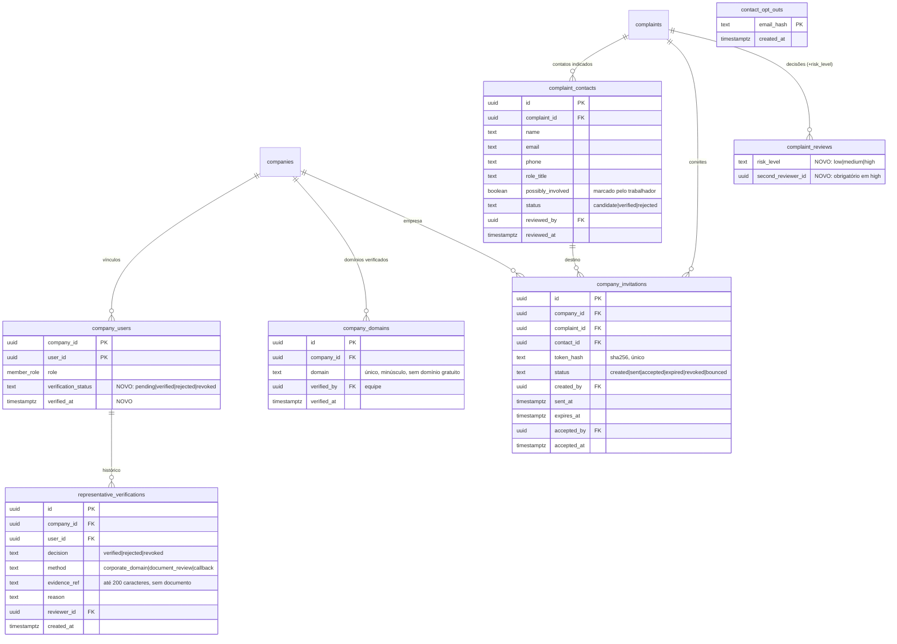
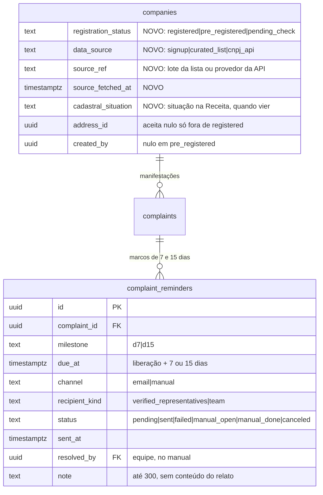

# ADR-0012 — Representante verificado e convite seguro à empresa

- Estado: **Proposta**, revisada em 2026-11-08 com as decisões do responsável sobre D7, base de empresas e prazos. Nenhuma migration foi criada.
- Data: 2026-11-06
- Tarefas: [TASK-0011](../tasks/TASK-0011-verificacao-de-contatos-empresariais.md) · [TASK-0029](../tasks/TASK-0029-convite-seguro-a-empresa-apos-manifestacao.md) · TASK-0031
- Relacionadas: ADR-0009, ADR-0010, ADR-0011

## Contexto (estado atual do código)

- Qualquer pessoa que cadastra um CNPJ ainda não usado vira `owner` da empresa em `company_users`. Não há prova de que representa a empresa (`companies.cnpj` é único, sem verificação).
- `public.is_company_user(company_id)` só confere o vínculo em `company_users`. É ela que libera `list_company_complaints`, `get_company_complaint_timeline` e `respond_complaint`.
- Depois da ADR-0010, a equipe libera a versão compartilhável (`shared`). Nada impede que a conta que a recebe seja da pessoa envolvida no relato, se ela cadastrou o CNPJ primeiro.
- O trabalhador só pode manifestar contra empresa já cadastrada (`create_complaint` exige `company_id`). Os contatos empresariais indicados no assistente (nome, e-mail, telefone, cargo, aviso sobre sócio/proprietário) ficam só na sessão do navegador; não são gravados.
- Não há registro de risco por manifestação, nem convite, nem envio de e-mail pela aplicação.

## Problema

1. **Representante (TASK-0011):** a liberação da ADR-0010 entrega o texto a quem tiver o vínculo, sem verificação. É o risco aberto do piloto.
2. **Convite (TASK-0029):** não há forma segura de trazer a empresa para a plataforma depois da manifestação, sem revelar o caso a destinatário errado ou à pessoa envolvida.

## Decisões propostas

D1. **Verificação por vínculo, não por empresa.** Cada linha de `company_users` ganha estado de verificação. Só o vínculo `verified` acessa manifestações. Portal, diretório de parceiros e perfil continuam acessíveis ao vínculo não verificado, que vê o aviso "aguardando verificação" e nenhum número de manifestações.

D2. **Gate no banco.** É criada `public.is_verified_company_user(company_id)`, que passa a substituir `is_company_user` nas três funções de manifestação e em `company_ranking.is_mine`. As demais funções (parceiros, conteúdos, contato) continuam com `is_company_user`.

D3. **Verificação feita pela equipe (manual no piloto).** Métodos aceitos:
- `corporate_domain`: e-mail de login confirmado pelo Supabase num domínio já verificado para a empresa;
- `document_review`: documento de representação conferido fora da plataforma, sem guardar o arquivo; registra-se só o tipo e a referência;
- `callback`: ligação ao telefone público da empresa.
Domínios de e-mail gratuitos (gmail, hotmail etc.) nunca contam como `corporate_domain`.

D4. **Contato indicado pelo trabalhador é candidato, nunca destino verificado.** Os contatos são gravados por manifestação, ficam visíveis só para o próprio trabalhador e para a equipe, e a empresa nunca os vê. A equipe marca cada contato como `verified` ou `rejected`. Um contato que o trabalhador marcou como possivelmente envolvido não pode receber convite.

D5. **Convite manual assistido no piloto.** A equipe gera o convite na Operação. O banco guarda só o hash do token, que é de uso único e expira em 7 dias. A pessoa da equipe envia o e-mail por fora, com texto mínimo aprovado, e marca como enviado. O texto não cita manifestação, protocolo, tema nem trabalhador; diz apenas que a empresa tem um canal de escuta à disposição na plataforma. Envio automático por provedor fica para outra ADR, com o DevOps.

D6. **O aceite do convite não dá acesso a manifestações.** O aceite liga a conta à empresa com vínculo `pending`. O acesso só vem com a verificação da D3. O link não carrega nem permite descobrir o ID da manifestação ou da empresa.

D7. **Risco registrado na decisão da equipe (confirmado pelo responsável em 2026-11-08).** Duas regras separadas:
- **Regra de risco:** a equipe registra `risk_level` (`low`, `medium`, `high`) em toda decisão de `complaint_reviews`. Com risco `high`: (1) nenhum convite ou lembrete automático é criado para aquela empresa enquanto o caso estiver aberto, só tarefa manual; (2) a liberação à empresa exige uma segunda pessoa da equipe, de outra conta de `platform_admins`, conferida no banco. Viável no piloto: são 4 pessoas na Operação.
- **Regra de urgência:** a urgência é só por tempo (D12: 7 e 15 dias). O `risk_level` não muda prazo, ordem da fila nem prioridade, e o tema da manifestação também não. Risco alto muda **o canal** (manual em vez de automático) e **quem libera** (duas pessoas), nunca a urgência.

D8. **Opt-out.** Uma lista de e-mails que pediram para não receber convites, guardada só como hash do e-mail normalizado. Antes de gerar o convite, o hash é conferido nessa lista.

### Revisão de 2026-11-08 (decisões do responsável)

D9. **Base de empresas = (a) + (b).** A empresa pode existir sem cadastro próprio, como **empresa pré-cadastrada**:
- (a) lista curada pela equipe, carregada por script operacional (fora do cadastro público), com origem `curated_list`;
- (b) busca por CNPJ numa API pública gratuita, que cria a empresa pré-cadastrada com origem `cnpj_api`. O provedor, os termos e o ponto da chamada (função de servidor ou navegador, como no ViaCEP da ADR-0006) ficam com o DevOps e o responsável; ver o parecer de plataforma, seção R2.5, opção C.
- Só dados da empresa: CNPJ, razão social, nome fantasia, situação cadastral, município e UF. **Sem quadro societário (QSA)**, sem e-mail ou telefone do cadastro da Receita e **sem MEI**: CNPJ de MEI é recusado (porte MEI ou optante pelo MEI na resposta da API), porque identifica uma pessoa física. Se a API não informar o porte, a empresa fica `pending_check` até a equipe conferir.
- Empresa pré-cadastrada não tem representante nem `company_users`, e o endereço completo não é obrigatório.

D10. **Empresa pré-cadastrada fica fora do diretório e do ranking.** `list_company_directory`, `company_ranking` (ou `company_responsiveness`, TASK-0036) e `list_partner_companies` passam a filtrar `registration_status = 'registered'`. O trabalhador chega a ela pela busca por CNPJ. A manifestação contra ela segue o fluxo normal: fica guardada ou vai para revisão (ADR-0010). A liberação não tem destinatário até existir representante verificado, e o caminho é o convite (D5).

D11. **Reivindicação da empresa pré-cadastrada.** Quando alguém se cadastra como empresa com um CNPJ que já existe como pré-cadastrado, o cadastro não falha por CNPJ duplicado: a conta é ligada a essa empresa com vínculo `pending`, e a empresa passa a `registered`. O acesso a manifestações continua dependendo da verificação (D1/D3). Uma segunda conta com o mesmo CNPJ entra como membro `pending`, nunca como dono automático.

D12. **Urgência só por tempo, nunca por tema.** Tema, categoria e conteúdo da manifestação não aceleram nem atrasam nada. Os marcos contam a partir da liberação à empresa (primeiro evento `shared`) enquanto não houver resposta da empresa (com a ADR-0013: resposta enviada, mesmo em revisão).

| Marco | Empresa com representante verificado | Empresa pré-cadastrada ou sem representante verificado |
|---|---|---|
| 7 dias | lembrete por e-mail aos representantes verificados, com texto mínimo ("há manifestação aguardando resposta"), sem tema nem protocolo | tarefa manual para a equipe na Operação: tentar convite ou contato verificado |
| 15 dias | lembrete mais urgente aos mesmos destinatários; o caso aparece destacado na fila da equipe | tarefa manual marcada como urgente para a equipe |

- O trabalhador não recebe esses avisos; ele vê o tempo decorrido no próprio acompanhamento.
- O envio continua pelo Gmail do SMTP atual até a troca prevista na Revisão 3 do parecer. O desenho do envio (fila, agendamento, reenvio, falha) é do DevOps. Esta ADR modela só os marcos e o registro.
- Caso de risco `high` (D7) não gera lembrete automático: os dois marcos viram tarefa manual da equipe.
- Cada marco é registrado uma única vez por manifestação, com estado, canal, destinatário e quem resolveu, para não reenviar e para auditoria.

## Modelo (ERD)

Acréscimos da revisão de 2026-11-08:

Regras: `unique (complaint_id, milestone)`; o marco é cancelado (`canceled`) se a empresa responder ou a manifestação for encerrada antes de `due_at`. Não há tabela de lista curada: o script insere em `companies` com `data_source = 'curated_list'`.

## Quem lê e quem escreve

| Tabela | Trabalhador | Empresa | Equipe (`platform_admins`) | Anônimo |
|---|---|---|---|---|
| `company_users.verification_status` | — | lê o próprio status via `current_profiles()` | altera via `ops_verify_representative` | — |
| `company_domains` | — | — | lê e escreve via `ops_*` | — |
| `representative_verifications` | — | — | lê e escreve via `ops_*` (só inserção) | — |
| `complaint_contacts` | escreve na criação e lê os próprios | **nunca** | lê e decide via `ops_*` | — |
| `company_invitations` | — | — | cria, marca enviado e revoga via `ops_*` | aceita só via `accept_company_invitation(token)` autenticado |
| `contact_opt_outs` | — | — | conferência interna | inserção via `opt_out_invitations(token)` |
| `complaint_reviews.risk_level` | — | — | grava em `ops_decide_complaint` | — |
| `companies` pré-cadastradas | encontra só pela busca por CNPJ (`find_company_by_cnpj`), sem ver se há manifestações | a conta que reivindica vira `pending` (D11) | lê e corrige via `ops_*`; carrega a lista curada por script | — |
| `complaint_reminders` | — | — | lê e resolve os manuais via `ops_*` | — |

RLS ligada em todas as tabelas novas. Nenhum `grant` direto a `anon` ou `authenticated`: o acesso é só por funções `security definer` com `search_path = ''`, no padrão das ADR-0010 e ADR-0011.

## Funções novas ou alteradas (assinaturas previstas)

- `is_verified_company_user(uuid) → boolean` (nova). Passa a ser usada em `list_company_complaints`, `get_company_complaint_timeline`, `respond_complaint` e `company_ranking`.
- `create_complaint(p jsonb, p_share boolean)`: aceita `p.contacts[]`, com até 3 contatos, e valida e-mail e telefone.
- `ops_decide_complaint(p_id, p_decision, p_reason, p_risk_level)` (nova versão): exige `p_risk_level`. Com risco `high`, a liberação exige uma segunda pessoa da equipe, diferente da primeira.
- `ops_list_representatives(p_status)`, `ops_verify_representative(p_company, p_user, p_decision, p_method, p_evidence_ref, p_reason)`, `ops_add_company_domain(p_company, p_domain)`.
- `ops_review_contact(p_contact, p_decision)`, `ops_create_invitation(p_contact) → text`. O token é devolvido uma única vez à equipe e só o hash fica no banco. Mais `ops_mark_invitation_sent(p_id)` e `ops_revoke_invitation(p_id)`.
- `accept_company_invitation(p_token text) → uuid` (autenticada): cria o vínculo `pending`. Qualquer token inválido, expirado ou revogado devolve a mesma mensagem de erro, para não permitir enumeração.
- `opt_out_invitations(p_token text)` (anônima): registra o hash do e-mail do destino.
- `find_company_by_cnpj(p_cnpj text) → table(id, name, city, state, registration_status)` (autenticada): valida os dígitos, devolve a empresa existente (cadastrada ou pré-cadastrada) e nunca informa número de manifestações. Se ela não existir, o front busca na API (ou chama a função de servidor que o DevOps definir) e envia o resultado a `preregister_company(p jsonb) → uuid`. Essa função recusa MEI, ignora o QSA e qualquer campo fora da lista da D9, grava `data_source = 'cnpj_api'` e tem limite de criação por conta e por hora.
- `private.create_profile`: no cadastro de empresa com CNPJ pré-cadastrado, aplica a D11 em vez de falhar.
- `ops_list_reminders(p_status text default 'manual_open')` e `ops_resolve_reminder(p_id uuid, p_note text)`. A criação dos marcos e o envio ficam com o agendamento que o DevOps escolher (por exemplo, `pg_cron` chamando `private.schedule_reminders()`); esta ADR só exige que a criação seja idempotente.

## Migração de dados

- Vínculos existentes em `company_users` passam a `pending`. As contas de demonstração (seed `@example.com`) recebem `verified` com método `document_review` e referência `seed-demo`, por script separado, nunca automático em produção.
- Valores novos de enum ou check ficam em migration separada, conforme o padrão do projeto.
- Ordem: (1) colunas e tabelas sem mudar acesso; (2) funções novas; (3) troca do gate (D2) por último, com teste de fumaça antes e depois.

## Riscos

- **Operação:** a verificação manual cria fila e atraso. A empresa liberada sem representante verificado fica com o caso pendente até a verificação.
- **Tenancy:** a troca do gate (D2) afeta todas as contas de empresa. Um erro pode esconder casos de quem tinha acesso ou mostrar a quem não tinha. Mitigação: teste de fumaça com dois tenants, vínculo `pending`, `revoked` e conta fora da empresa.
- **Dados pessoais novos:** `complaint_contacts` grava nome, e-mail, telefone e cargo de terceiros, indicados pelo trabalhador. Exige base legal e prazo de retenção (TASK-0007); proposta inicial: apagar os contatos 90 dias após o encerramento.
- **Convite:** mesmo sem detalhes, um convite logo após um conflito pode sugerir à pessoa envolvida que houve manifestação. Mitigações: D4, D7, intervalo mínimo e texto genérico. O risco residual exige decisão humana.
- **Token:** o link pode ser encaminhado. Como o aceite só cria vínculo `pending` (D6), encaminhar não dá acesso a manifestações.
- **Empresa pré-cadastrada:** qualquer pessoa autenticada pode criar uma pela busca. Mitigações: dígitos validados, recusa de MEI, limite por conta e ausência no diretório e no ranking. Uma empresa criada por engano fica invisível até ter manifestação liberada e representante.
- **Dado de terceiro:** a API pode trazer o nome de uma pessoa na razão social de empresa individual que não é MEI. A equipe confere antes do convite; o dado só aparece para a equipe e para quem buscou o CNPJ.
- **Lembretes:** sem o mecanismo de envio pronto, os marcos ficam só como tarefa manual. Um lembrete com detalhe do caso exporia o trabalhador; por isso o texto é fixo e mínimo.

## Decisões que dependem do responsável

1. Aprovar D1–D8, especialmente: vínculo não verificado sem acesso a manifestações (D1), segunda pessoa da equipe para risco alto (D7) e convite manual no piloto (D5).
2. Métodos de verificação aceitos (D3) e quem na equipe pode verificar.
3. Texto do convite e da página de destino. Não deve conter promessa de anonimato.
4. Base legal e retenção de `complaint_contacts` e `contact_opt_outs` (TASK-0007).
5. ~~Se manifestação contra empresa não cadastrada entra no piloto~~: decidido em 2026-11-08; entra como empresa pré-cadastrada (D9 a D11).
6. Provedor da API de CNPJ, termos de uso e ponto da chamada (com o DevOps).
7. Texto fixo dos lembretes de 7 e 15 dias (D12).
8. O que fazer se a empresa pré-cadastrada continuar sem representante depois do marco de 15 dias: encerrar com aviso ao trabalhador, manter aberta ou outra saída.

## Testes de fumaça previstos

Empresa pré-cadastrada fora do diretório e do ranking; MEI recusado; QSA ignorado; reivindicação cria vínculo `pending`; marcos criados uma única vez, cancelados com resposta e sem lembrete automático em risco alto; tema não altera prazo. Dois tenants; vínculo `pending` não vê caso liberado; `verified` vê; `revoked` deixa de ver; contato de outra manifestação não é visível; convite com token reutilizado, expirado ou revogado é recusado com a mesma mensagem; aceite cria só vínculo `pending`; risco alto bloqueia convite e exige segunda pessoa da equipe; opt-out bloqueia novo convite; empresa nunca lê `complaint_contacts`.

## Rollback

- Antes da troca do gate: remover as tabelas e colunas novas; não há dado dependente.
- Depois da troca: reaplicar `is_company_user` nas funções de manifestação apenas se a verificação travar a operação, e com decisão registrada, porque isso reabre o risco do representante não verificado. Convites pendentes são revogados (`revoked`); nada é apagado da trilha.
