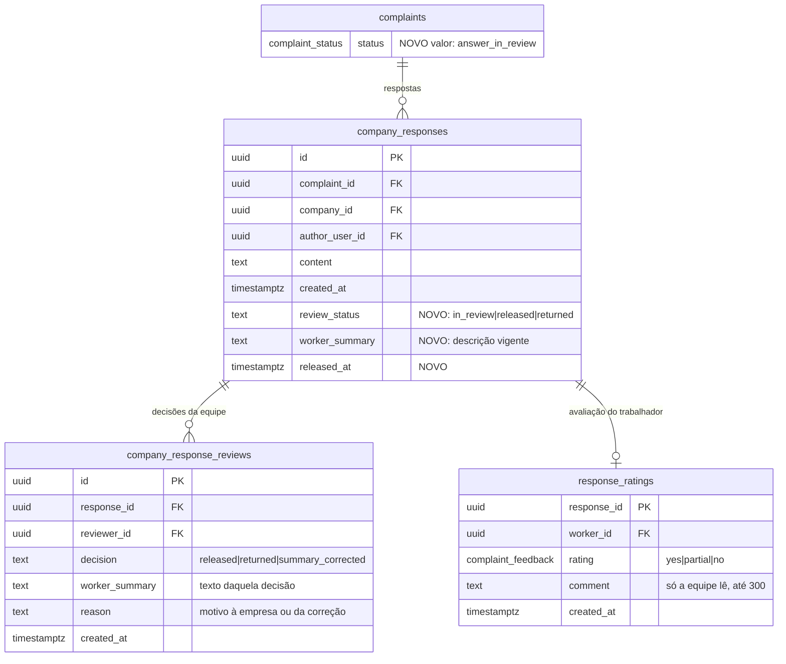

# ADR-0013 — Resposta da empresa revisada pela equipe antes de chegar ao trabalhador

- Estado: **Proposta**, aguardando aprovação do responsável. Nenhuma migration foi criada.
- Data: 2026-11-08
- Tarefa: [TASK-0035](../tasks/TASK-0035-resposta-da-empresa-revisada.md)
- Relacionadas: ADR-0010 (revisão antes de liberar à empresa), [TASK-0036](../tasks/TASK-0036-ranking-sem-volume-e-sem-posicao.md) (ranking), TASK-0031

## Decisão de produto já tomada pelo responsável

A resposta da empresa passa pela equipe antes de chegar ao trabalhador. A equipe escreve uma descrição que o trabalhador lê para avaliar se a resposta valeu a pena.

## Estado atual do código (schema em produção, 12 migrations)

- `respond_complaint(p_id, p_content)` grava em `company_responses` (`content`, `author_user_id`, `created_at`), muda a manifestação para `answered` e cria o evento `answered` com a nota "Empresa enviou uma resposta institucional."
- O trabalhador lê `company_responses` e `complaint_events` **direto pelas tabelas** (políticas `responses_read_worker` e `events_read_worker`), e o front (`src/services/data.ts`) faz `select` nas duas. Hoje a resposta chega ao trabalhador no mesmo instante em que é enviada.
- A empresa pode responder de novo enquanto o caso está em `shared` ou `answered`.
- A avaliação do trabalhador existe só no encerramento: `complaints.worker_feedback` (`yes`, `partial`, `no`), gravada por `close_complaint`. O ranking não a usa.
- `company_ranking` já conta o prazo até `min(company_responses.created_at)`, isto é, até o envio da empresa, a partir da liberação (migration 20261106140000).

## Problema

1. Uma resposta pode conter conteúdo inadequado: pressão, indício de retaliação, tentativa de identificar o trabalhador ou dado pessoal. Hoje ela chega sem filtro.
2. O trabalhador precisa de uma leitura clara para avaliar se a resposta resolveu. Texto jurídico ou institucional nem sempre permite isso.
3. A revisão não pode piorar a posição da empresa no ranking por causa da fila interna.

## Decisões propostas

### D1. Estados

Novo valor do enum `complaint_status`, em migration própria: `answer_in_review`. `answered` passa a significar "resposta liberada ao trabalhador".

```
shared ──(empresa responde)──▶ answer_in_review ──(equipe libera)──▶ answered
   ▲                                │
   └──────(equipe devolve)──────────┘   motivo visível à empresa
answered ──(empresa responde de novo)──▶ answer_in_review
```

Cada resposta tem estado próprio em `company_responses.review_status`: `in_review`, `released` ou `returned`.

Recomendo não usar o par `answered_pending_review`/`answer_released`. Manter `answered` com o significado de liberada evita mexer no ranking, na lista da empresa e nos rótulos que já tratam `answered`.

### D2. O que a empresa vê

- A empresa vê o estado da própria resposta: "Em revisão pela equipe", "Liberada ao trabalhador" ou "Devolvida para ajuste", com o motivo.
- A empresa **não** vê a descrição que a equipe escreveu para o trabalhador. Recomendo assim porque a descrição é uma leitura para o trabalhador e pode citar expectativas dele.
- Com a resposta em revisão, a empresa não envia outra. Depois de devolvida, envia uma nova resposta, em outra linha. A devolvida fica na trilha.

### D3. O que o trabalhador vê (decisão do responsável)

| Opção | O trabalhador vê | A favor | Contra |
|---|---|---|---|
| **3A** | só a descrição da equipe | protege o trabalhador de texto inadequado; leitura simples | o trabalhador não lê a palavra da própria empresa; a equipe vira intérprete e pode ser acusada de distorcer |
| **3B** | a descrição da equipe e, abaixo, a resposta original da empresa (já revisada) | transparência; o trabalhador avalia por conta própria | um texto inadequado só é barrado se a equipe devolver; exige devolver em vez de "suavizar" |

Recomendação: **3B**, com a regra de que a equipe nunca libera um texto inadequado, e sim o devolve à empresa (D4). Na 3A, a coluna `content` deixa de ser legível pelo trabalhador (o `grant select` por coluna sai) e a resposta chega a ele só pela descrição.

### D4. Quem edita e quando

- **Empresa:** não edita a resposta enviada. Só envia outra depois de uma devolução ou de uma liberação.
- **Equipe (`private.platform_admins`):** não edita o texto da empresa. Para cada resposta em revisão, decide:
  - `released`: exige a descrição para o trabalhador (`worker_summary`, de 30 a 1.000 caracteres);
  - `returned`: exige motivo de 10 a 500 caracteres, que vai à empresa.
- **Correção da descrição depois de liberada:** permitida à equipe, com motivo obrigatório. Gera nova linha na trilha. O trabalhador vê a versão mais recente com a marca "descrição corrigida em DD/MM".
- **Trilha em tabela própria**, `company_response_reviews`, porque `complaint_reviews` registra a liberação da manifestação à empresa (ADR-0010). Misturar as duas confundiria `ops_complaint_timeline` e as métricas.
- Toda decisão trava a linha da resposta (`for update`), seguindo o padrão da 20261106140000.

### D5. Avaliação do trabalhador ("valeu a pena?")

- Por resposta liberada, opcional, uma única vez: `yes`, `partial` ou `no`, com comentário curto opcional que só a equipe lê (até 300 caracteres). Tabela `response_ratings`.
- A avaliação de encerramento (`complaints.worker_feedback`) continua como está. Recomendo que o ranking use a avaliação da **primeira resposta liberada** de cada caso, que mede a primeira reação da empresa e não é diluída por respostas seguintes.
- A empresa não vê a avaliação individual de cada caso, só o agregado no ranking. Isso reduz pressão sobre o trabalhador.

### D6. Efeito no ranking

- **Prazo de resposta:** continua de `released_at` da manifestação (primeiro evento `shared`) até o `created_at` da **primeira resposta da empresa que depois foi liberada**. O tempo em revisão pela equipe não conta. Uma resposta devolvida não para o relógio: do contrário, a empresa poderia enviar qualquer texto só para registrar prazo.
- **Taxa de resposta:** casos com ao menos uma resposta liberada sobre casos liberados. Uma resposta só em revisão ainda não conta.
- **Satisfação:** nova métrica a partir da D5 (`yes` = 1, `partial` = 0,5, `no` = 0), exibida só com 3 ou mais avaliações. O formato de exibição segue a TASK-0036 (faixas, sem posição).

## Modelo (ERD)



## Quem lê e quem escreve

| Dado | Trabalhador | Empresa | Equipe |
|---|---|---|---|
| `company_responses.content` | lê só `released` (opção 3B); não lê na 3A | lê as próprias, por RPC | lê todas, por `ops_*` |
| `review_status`, `released_at` | lê só `released` | lê as próprias | lê e altera por `ops_decide_response` |
| `worker_summary` | lê só `released` | **não lê** | escreve por `ops_*` |
| `company_response_reviews` | — | lê só `reason` das devolvidas, por RPC | lê e insere por `ops_*` |
| `response_ratings` | escreve uma vez e lê a própria, por RPC | só o agregado, no ranking | lê, por `ops_*` |
| evento `answer_in_review` | lê, como "A empresa respondeu. A equipe revisa antes de você receber." | não aparece na timeline dela | lê |

Mudanças de RLS:
- `responses_read_worker` passa a exigir `review_status = 'released'`.
- Na opção 3A, `content` sai do `grant select` do `authenticated`; leitura só pela RPC do trabalhador.
- `company_response_reviews` e `response_ratings` ficam sem `grant` direto.

## Funções (assinaturas previstas)

- `respond_complaint(p_id, p_content)`: grava `review_status = 'in_review'`, muda a manifestação para `answer_in_review` e recusa quando já há resposta em revisão. Erro P0001: "Já existe uma resposta em revisão pela equipe."
- `get_company_complaint_timeline(p_id)`: inclui `review_status` e o motivo de devolução das respostas da própria empresa.
- `ops_list_responses(p_status text default 'in_review')`: lista sem identidade do trabalhador.
- `ops_decide_response(p_response uuid, p_decision text, p_summary text, p_reason text)`:
  - `released`: muda a manifestação para `answered` e grava o evento "Resposta da empresa liberada.";
  - `returned`: volta para `shared` e grava o evento "Resposta devolvida à empresa para ajuste." (visível só à equipe e à empresa).
- `ops_correct_response_summary(p_response, p_summary, p_reason)`.
- `rate_response(p_response uuid, p_rating complaint_feedback, p_comment text default null)`: só o dono, só `released`, uma vez.
- `company_ranking`: muda conforme a D6 e a TASK-0036.
- `ops_metrics`: ganha `responses_in_review` e `avg_hours_response_review`.

## Migração

1. Enum `answer_in_review` em migration própria.
2. Colunas e tabelas novas. As respostas existentes recebem `review_status = 'released'`, `released_at = created_at` e `worker_summary` nulo. Na 3A, o front mostra "Resposta anterior à revisão" quando não houver descrição.
3. Funções novas, RLS e o novo `respond_complaint`.
4. Front: portais do trabalhador e da empresa e a fila de respostas na Operação, publicados junto com o passo 3 ou com um front tolerante antes.

## Riscos

- **Operação:** segunda fila humana por caso, que dobra o custo de revisão. Sem SLA, a resposta pode demorar a chegar ao trabalhador, sem prejudicar a empresa no ranking.
- **Confiança:** na 3A, a equipe é a única voz que o trabalhador ouve. A trilha de correções e o motivo obrigatório reduzem a acusação de distorção, mas não a eliminam.
- **Privacidade:** `response_ratings.comment` é texto livre do trabalhador. Fica limitado a 300 caracteres e só a equipe lê.
- **Compatibilidade:** o front em produção lê `company_responses` direto. A troca de RLS sem o front novo esconde respostas novas (falha fechada) e mostra estados sem rótulo, como aconteceu na ADR-0010.

## Testes de fumaça previstos

- Resposta nova fica `in_review` e o trabalhador não a lê, nem pela tabela nem pela RPC.
- Empresa vê "em revisão", mas não vê `worker_summary`; segunda resposta com uma em revisão é recusada.
- Equipe libera sem descrição → erro; com descrição → trabalhador lê. Na 3A, o trabalhador não lê `content`.
- Devolução exige motivo; empresa lê o motivo; manifestação volta a `shared`; uma nova resposta é aceita.
- Decisão repetida é recusada (trava); conta sem papel de equipe é barrada.
- `rate_response` só para o dono, só para resposta liberada, uma vez.
- Ranking: prazo conta até o envio da resposta liberada; resposta devolvida não para o relógio; tempo em revisão não conta; satisfação só com 3 ou mais avaliações.
- Outra empresa não vê nada do caso.

## Rollback

- Antes de existir resposta em revisão: reaplicar o `respond_complaint` anterior e a política antiga; as colunas novas podem ficar, porque não quebram nada.
- Com respostas em revisão: liberar ou devolver todas pela Operação antes de reverter. Nunca reverter tornando visível ao trabalhador uma resposta que não passou pela equipe.
- O valor de enum não pode ser removido com facilidade no Postgres; ele fica sem uso.

## Decisões que dependem do responsável

1. Opção 3A ou 3B (recomendação: 3B).
2. Se a empresa vê o estado "em revisão" e o motivo da devolução (recomendação: sim) e se vê a descrição da equipe (recomendação: não).
3. Avaliação por resposta liberada, com o ranking usando a primeira (D5), ou só no encerramento, como hoje.
4. Peso de `partial` (0,5) e se a satisfação entra no ranking no piloto.
5. SLA da equipe para revisar respostas e quem cobre a fila.
