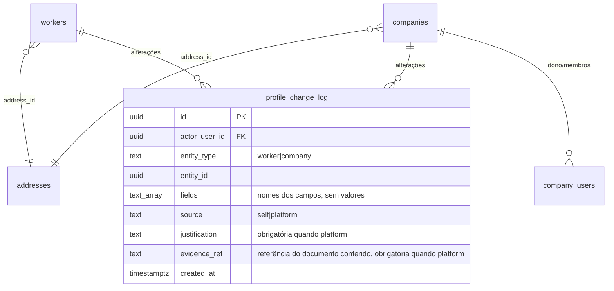

# ADR-0014 — "Meu perfil" do trabalhador e da empresa: atualização por RPC com trilha

- Estado: **Aceita** pelo responsável em 2026-11-08; implementação na migration `20261108120000_meu_perfil.sql` (branch `feat/meu-perfil`, ainda não aplicada no remoto).
- Data: 2026-11-08
- Tarefa: [TASK-0037](../tasks/TASK-0037-meu-perfil-trabalhador-e-empresa.md)
- Relacionadas: ADR-0009 (entidades por tipo e endereço), ADR-0012 (representante verificado, em proposta), ADR-0011 (equipe)

## Decisões do responsável (2026-11-08)

- C1: razão social travada junto com o CNPJ. Troca só pela equipe.
- C2: membro da empresa só lê; só o dono edita.
- C3: trilha sem valores.
- C4 (decidido em 2026-11-08): **só o responsável** troca CPF, CNPJ e razão social, mediante documento. Privilégio próprio `private.document_officers`, separado de `platform_admins` e concedido só à conta dele por script operacional, fora do cadastro e das migrations. Outros integrantes da equipe não trocam. A troca exige motivo e referência curta do documento conferido (`evidence_ref`, como na ADR-0012), sem guardar o arquivo.
- C5 (pendente): conferir no painel que a troca de e-mail exige dupla confirmação no remoto antes de liberar a tela.

## Estado anterior do código (conferido no banco local, igual às 12 migrations de produção)

A edição já existe pelas tabelas, sem RPC, sem validação além das `check` e sem trilha:

| Tabela | Colunas com `UPDATE` para `authenticated` | Política |
|---|---|---|
| `workers` | `full_name`, `phone` | `user_id = auth.uid()` |
| `companies` | `legal_name`, `trade_name`, `contact_email`, `contact_phone` | `is_company_owner(id)` |
| `addresses` | todas (CEP, logradouro, número, complemento, bairro, cidade, UF) | `owns_address(id)` |
| `partners` | `display_name`, `specialty`, `description`, `avatar_media_id` | dono (fora do escopo) |

O front usa hoje só `companies.update` (contato) e `partners.update`. Não há tela de perfil do trabalhador.

Achados:
1. **A razão social (`legal_name`) é editável pelo dono**, embora seja ligada ao CNPJ, que é travado.
2. **Qualquer membro da empresa, não só o dono, altera o endereço da empresa**: `owns_address` aceita qualquer vínculo em `company_users`, enquanto `companies` exige dono.
3. A validação de CPF e CNPJ (dígitos verificadores) existe só no navegador. O banco confere apenas o formato. Telefone, CEP e UF têm `check` de formato no banco.
4. Nenhuma alteração de perfil fica registrada.

## Decisões propostas

D1. **Edição só por RPC.** Os `grant update` diretos de `workers`, `companies` e `addresses` saem para `authenticated`. As políticas de `update` são removidas, porque deixam de ter uso. `partners` fica como está, numa tarefa à parte.

D2. **Campos editáveis.**

| Perfil | Editável pela própria pessoa | Travado |
|---|---|---|
| Trabalhador | nome completo, telefone, endereço | CPF |
| Empresa (somente o dono) | nome fantasia, e-mail e telefone de contato, endereço | CNPJ, **razão social** (recomendado travar junto com o CNPJ) |
| Empresa (membro) | nada; só leitura | — |

D3. **CPF, CNPJ e razão social só pelo responsável** (C4), com `ops_change_document(p_entity text, p_id uuid, p_new_value text, p_justification text, p_evidence_ref text)`. Exige vínculo em `private.document_officers`, motivo de 10 a 500 caracteres, referência do documento de 3 a 200 caracteres e validação de dígitos no banco. A trilha guarda quem, quando, qual campo, motivo e referência, sem o valor antigo nem o novo.

D4. **E-mail de login pelo Supabase Auth**: `supabase.auth.updateUser({ email })`. O `config.toml` já tem `double_confirm_changes = true`, então a troca exige confirmação no endereço atual e no novo. A confirmação no projeto remoto precisa ser conferida no painel antes de liberar a tela. Nenhuma RPC mexe em `auth.users`. O e-mail de contato da empresa (`contact_email`) é outro dado, editado pela RPC.

D5. **Validações iguais às do cadastro, no banco.**
- Novas funções `private.valid_cpf(text)` e `private.valid_cnpj(text)`, com dígitos verificadores e CNPJ alfanumérico (valor = código ASCII − 48), também usadas por `private.create_profile` e por `ops_change_document`.
- Nome com 2 a 160 caracteres, espaços nas pontas removidos.
- Telefone: só dígitos; DDD mais fixo (8) ou celular (9), igual à `check` atual.
- Endereço: CEP com 8 dígitos, UF em `^[A-Z]{2}$`, número obrigatório e tipo de logradouro do enum.
- Erros em P0001 com a mesma mensagem do cadastro, para o front reaproveitar os toasts.

D6. **Trilha mínima**, na tabela `profile_change_log`:
- campos: `id`, `actor_user_id`, `entity_type` (`worker` ou `company`), `entity_id`, `fields text[]` (só os nomes dos campos alterados; mudanças de endereço entram como `address.<campo>` na entidade dona), `source` (`self` ou `platform`), `justification` (obrigatória quando `platform`), `created_at`;
- uma chamada que não muda nada não grava linha;
- não guarda valores, para não duplicar dado pessoal nem criar histórico de endereço;
- só a equipe lê, por `ops_profile_changes(p_entity_id)`.

D7. **Sem efeito nas manifestações.** A empresa nunca vê nome, telefone nem endereço do trabalhador, e a mudança de perfil não altera isso. O nome fantasia novo aparece no diretório e no ranking.

## Modelo (ERD)

Não há tabela nem coluna nova nas entidades existentes. Mudam grants, políticas e funções.

## Quem lê e quem escreve

| Dado | Trabalhador | Dono da empresa | Membro da empresa | Equipe |
|---|---|---|---|---|
| nome e telefone do trabalhador | lê e altera por RPC | — | — | lê por `ops_*` só se houver necessidade operacional (não previsto agora) |
| endereço do trabalhador | lê e altera por RPC | — | — | — |
| nome fantasia e contato da empresa | — | lê e altera por RPC | lê | lê |
| endereço da empresa | — | lê e altera por RPC | lê | lê |
| CPF, CNPJ, razão social | lê o próprio CPF | lê | lê | só quem está em `private.document_officers` (o responsável) altera por `ops_change_document` |
| `profile_change_log` | — | — | — | lê |

## Funções (assinaturas previstas)

- `update_worker_profile(p jsonb) → void`. Chaves: `full_name`, `phone`, `address` (objeto com os campos do cadastro). Aceita atualização parcial e ignora chaves desconhecidas; `cpf` presente gera o erro "O CPF só pode ser alterado pela equipe."
- `update_company_profile(p_company uuid, p jsonb) → void`. Só o dono (`is_company_owner`). Chaves: `trade_name`, `contact_email`, `contact_phone`, `address`. `cnpj` ou `legal_name` geram o erro "Este dado só pode ser alterado pela equipe."
- `ops_change_document(p_entity text, p_id uuid, p_new_value text, p_justification text, p_evidence_ref text) → void`.
- `ops_profile_changes(p_entity_id uuid) → table(entity_type text, fields text[], source text, justification text, evidence_ref text, actor_user_id uuid, created_at timestamptz)`, para `platform_admins` e `document_officers`.
- `private.valid_cpf(text)`, `private.valid_cnpj(text) → boolean`.

`updateCompanyContact` em `src/services/data.ts` passa a chamar `update_company_profile`. O front de produção atual usa `companies.update` para o contato; por isso o `revoke` só pode entrar junto com o front novo ou depois dele.

## Riscos

- **Compatibilidade:** retirar o `grant update` antes do front novo quebra a edição de contato da empresa. O erro aparece no toast; nada é perdido.
- **Dado pessoal:** a trilha guarda quem mudou o quê e quando, sem valores, o que é suficiente para auditoria mínima. Se for preciso recuperar o valor antigo (por exemplo, em fraude), não há como; a alternativa exigiria guardar valores, com outra base legal e retenção.
- **Troca de e-mail:** com a dupla confirmação desligada no remoto, quem tem a sessão aberta troca o e-mail da conta. Conferir antes da tela.
- **Endereço compartilhado:** um endereço pertence a uma única entidade (`address_id` único em `companies`); manter assim na RPC.

## Testes de fumaça previstos

- Trabalhador altera nome, telefone e endereço; CPF no payload é recusado; outro trabalhador não altera.
- `update` direto nas tabelas é negado depois do `revoke`.
- Dono altera nome fantasia, contato e endereço; membro é recusado; razão social e CNPJ são recusados.
- Telefone, CEP e UF inválidos são recusados com a mensagem do cadastro.
- `private.valid_cpf` e `private.valid_cnpj` (incluindo alfanumérico) batem com os casos do front.
- `ops_change_document` exige equipe e justificativa e valida dígitos; a trilha registra os campos sem valores.
- `profile_change_log` não é legível por `authenticated`.

## Rollback

Reconceder os `grant update` por coluna e recriar as políticas antigas. As RPCs podem ficar. A tabela de trilha só é removida com decisão sobre os registros.

## Decisões que dependem do responsável

1. Travar a razão social junto com o CNPJ (recomendado) ou mantê-la editável pelo dono.
2. Membro da empresa só lê (recomendado), corrigindo o achado 2, ou também edita endereço e contato.
3. Trilha sem valores (recomendado) ou com valores antigos, o que exige base legal e retenção.
4. ~~Quem troca CPF, CNPJ e razão social~~: decidido (C4), só o responsável, mediante documento.
5. Confirmar no painel que a troca de e-mail exige dupla confirmação no remoto.

## Implementação (2026-11-08)

Migration `20261108120000_meu_perfil.sql`:
- `private.valid_cpf(text)` e `private.valid_cnpj(text)` (CNPJ alfanumérico: valor = ASCII − 48). `private.create_profile` passa a recusar documento com dígito inválido (`22023`, "CPF inválido"/"CNPJ inválido").
- `private.update_address(uuid, jsonb)`: exige o endereço completo e devolve os campos alterados.
- `update_worker_profile(p jsonb)`, `update_company_profile(p_company uuid, p jsonb)`, `ops_change_document(p_entity text, p_id uuid, p_new_value text, p_justification text, p_evidence_ref text)` (`worker_cpf`, `company_cnpj`, `company_legal_name`; só `private.document_officers`) e `ops_profile_changes(p_entity_id uuid)`.
- `private.document_officers (user_id, granted_at)`: concessão manual pelo SQL Editor com o id da conta do responsável (comando no fim da migration); nunca por migration nem pelo cadastro.
- Tabela `profile_change_log`, sem grant a `anon`/`authenticated`.
- Saem as políticas `workers_update`, `companies_update` e `addresses_update` e o `update` direto do `authenticated` nas três tabelas. `owns_address` continua valendo para leitura (o membro lê o endereço da empresa); a edição passa a exigir dono pela RPC.
- Teste de fumaça: `supabase/tests/profile_smoke.sql` (33 verificações, inclusive admin sem o privilégio recusado, admin com o privilégio aceito e troca sem referência recusada). `content_contact_smoke.sql` passou a usar `update_company_profile`.
- O `revoke` vai no mesmo PR do front novo: o front de produção ainda usa `companies.update` para o contato da empresa.

## Adendo de 2026-11-09: CPF único por trabalhador

- **Contexto:** `public.workers.cpf` não tinha restrição de unicidade; só `companies.cnpj` tinha. A 20261109130000 passou a recusar CPF repetido na troca pela equipe (`ops_change_document`), mas o cadastro ainda aceitava.
- **Decisão do responsável:** CPF único no banco, com mensagem genérica no cadastro.
- **Implementação:** migration `20261109140000_cpf_unico.sql`, com a restrição `workers_cpf_key` e `private.create_profile` relançando `unique_violation` como 'Não foi possível concluir o cadastro.' (23505), sem DETAIL. Cobre o signUp (gatilho) e `add_profile`, os únicos caminhos de INSERT em `workers`.
- **Privacidade:** a mensagem não distingue CPF repetido de inválido, e o valor não vai ao erro nem ao log. O risco residual de enumeração (CPF válido mais erro) fica registrado; rate limit e captcha ficam para decisão à parte.
- **Rollback:** `alter table public.workers drop constraint workers_cpf_key;` e reaplicar `private.create_profile` de `20261108120000_meu_perfil.sql`. Nenhum dado muda.
