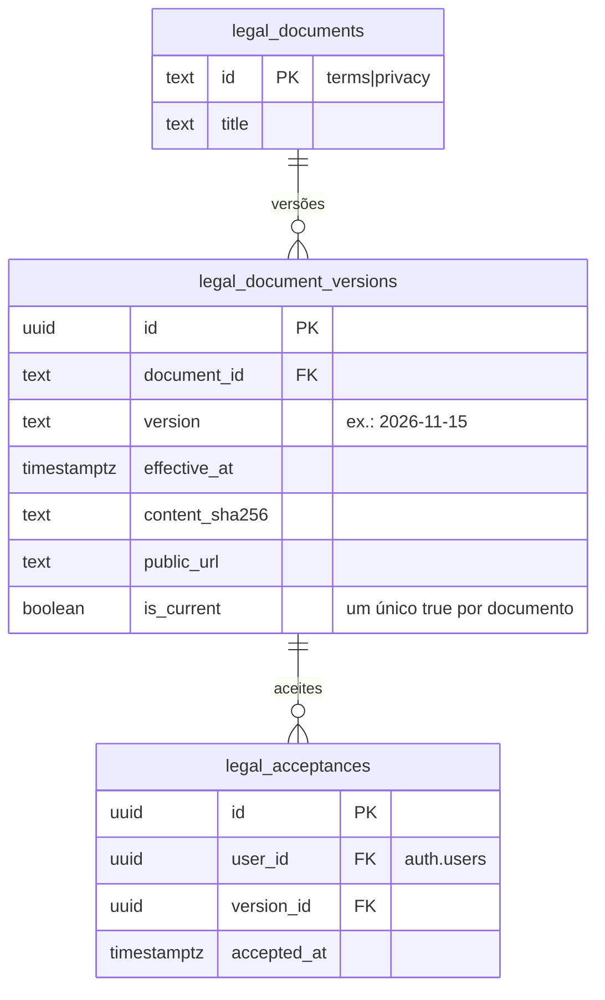

# ADR-0015 — Termos obrigatórios no cadastro, com aceite versionado

- Estado: **Proposta**, aguardando aprovação do responsável. Nenhuma migration foi criada.
- Data: 2026-11-08
- Relacionadas: ADR-0009 (cadastro), ADR-0014 (perfil), TASK-0007 (base legal e retenção), parecer jurídico de 2026-11 (seção 6.2: termos de uso, aviso de privacidade e comunicações coerentes entre si)

## Contexto

O cadastro não pede aceite de termos de uso nem de aviso de privacidade, e não há registro de quem aceitou o quê. Há 27 contas em produção (dump de 2026-11-08). O texto dos termos vem do jurídico; esta ADR trata só do mecanismo.

## Decisões propostas

D1. **Documentos versionados.** Cada documento legal (termos de uso, aviso de privacidade) tem versões imutáveis: identificador de versão, data de vigência, hash SHA-256 do texto publicado e o endereço onde o texto fica. O texto em si fica no front, versionado no Git, e o banco guarda o hash para provar qual texto foi aceito.

D2. **Aceite registrado por conta.** O aceite grava conta, documento, versão e data/hora. Não grava IP nem dispositivo, seguindo o parecer (seção 6.1: não coletar IP por padrão sem finalidade). O registro é só de inserção: não se edita nem apaga pela API.

D3. **Aceite obrigatório no cadastro.** O formulário mostra os documentos vigentes e exige a marcação. O signUp envia as versões aceitas em `signup.accepted_versions`. `private.create_profile` recusa versão ausente ou diferente da vigente e grava os aceites na mesma transação do cadastro. Lembrete: esse erro chega ao front como o 500 genérico do Auth, então a validação também fica no front.

D4. **Reaceite no próximo login.** Contas sem aceite da versão vigente (todas as 27 atuais e qualquer conta quando sair versão nova) veem uma tela de aceite antes do portal. Até aceitar, a conta não usa o portal.

D5. **Gate também no banco.** As RPCs que escrevem em nome da conta (criar e compartilhar manifestação, responder, decidir pela empresa, perfil, campanhas, conteúdos) passam a exigir aceite vigente, com erro P0001 "Aceite os termos atualizados para continuar." A leitura não é bloqueada, para a pessoa conseguir ver o próprio histórico. A equipe (`platform_admins`) também aceita.

D6. **Publicar nova versão é operação controlada**, por script ou por RPC restrita a `private.document_officers` (ADR-0014). Nunca pelo front.

## Modelo (ERD)

`unique (user_id, version_id)`; índice parcial `unique (document_id) where is_current`.

## Quem lê e quem escreve

| Dado | Conta autenticada | Anônimo | Equipe | Responsável (`document_officers`) |
|---|---|---|---|---|
| versões vigentes | lê, por `current_legal_versions()` | lê (a tela de cadastro precisa mostrar) | lê | publica nova versão |
| aceites | insere e lê os próprios, por `accept_legal_versions(uuid[])` e `pending_legal_acceptances()` | — | lê contagens agregadas por `ops_*` | — |

## Funções previstas

- `current_legal_versions() → table(document_id, version, effective_at, public_url, content_sha256)`, para `anon` e `authenticated`.
- `pending_legal_acceptances() → table(document_id, version_id, version)`: versões vigentes que a conta ainda não aceitou.
- `accept_legal_versions(p_versions uuid[]) → void`: aceita só versões vigentes; repetição é ignorada.
- `private.has_current_acceptance(uuid) → boolean`, usada pelas RPCs de escrita (D5).
- `ops_publish_legal_version(p_document text, p_version text, p_sha256 text, p_url text, p_effective_at timestamptz)`, só para `document_officers`.

## Riscos

- **Compatibilidade:** o gate da D5 bloqueia todas as escritas das contas atuais até o reaceite. O front com a tela de aceite precisa ir ao ar junto ou antes.
- **Base legal:** aceite de termos não substitui a base legal do tratamento. O parecer alerta que consentimento em contexto laboral pode não ser livre. A ADR não trata aceite como consentimento para tratar dado do trabalhador.
- **Retenção:** os aceites são prova; o prazo de guarda depende da TASK-0007.

## Testes de fumaça previstos

Cadastro sem versão é recusado; com versão antiga é recusado; com a vigente grava os aceites; conta sem aceite recebe erro nas RPCs de escrita e consegue ler; após `accept_legal_versions` volta a escrever; nova versão publicada torna a conta pendente; só `document_officers` publica; aceite não pode ser alterado nem apagado por `authenticated`.

## Rollback

Remover o gate das RPCs (reaplicar as versões anteriores) e esconder a tela de aceite. Os aceites já gravados ficam como registro.

## Decisões que dependem do responsável

1. Quais documentos entram (termos e aviso de privacidade separados ou um só) e o texto, com o jurídico.
2. Gate no banco para escrita (D5, recomendado) ou só no front.
3. Se a equipe também precisa aceitar (recomendado: sim).
4. Quem publica nova versão (proposta: o responsável, pelo privilégio de documentos).
