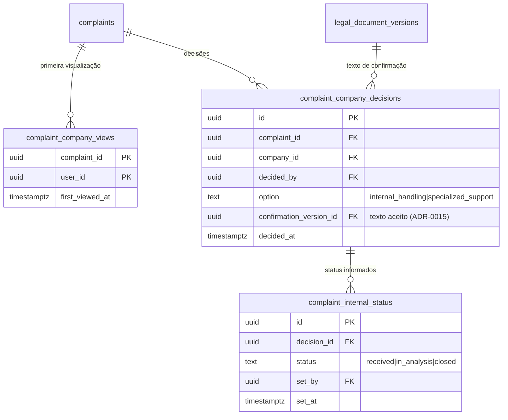

# ADR-0016 — Registro da decisão "Vou tratar internamente"

- Estado: **Proposta**, aguardando aprovação do responsável. Nenhuma migration foi criada.
- Data: 2026-11-08
- Relacionadas: parecer jurídico de 2026-11 (seções 4.3, 6.1 e 7.3), ADR-0010 (liberação), ADR-0012 (representante verificado), ADR-0013 (resposta revisada), ADR-0015 (aceite versionado), TASK-0032 (orientação especializada avulsa)

## Contexto

Pelo parecer, depois de receber a manifestação a empresa escolhe conduzir o tratamento internamente ou contratar apoio especializado. O registro da opção "Vou tratar internamente" tem valor probatório da escolha e da ciência da empresa, mas não exonera a plataforma, não é quitação nem renúncia do trabalhador. O parecer (seção 6.1) recomenda demonstrar no mínimo:
- protocolo, empresa e usuário empresarial autorizado que decidiu;
- data/hora da disponibilização e da confirmação de acesso/ciência;
- opção escolhida, versão do texto de confirmação e data/hora do aceite;
- registro protegido contra alteração, com trilha e retenção;
- status posterior só se necessário e proporcional, sem pedir relato da investigação.

Hoje não existe nada disso no banco. A empresa só lista, lê a versão compartilhável e responde.

## Decisões propostas

D1. **Primeira visualização registrada.** Quando um usuário verificado da empresa (ADR-0012) abre pela primeira vez uma manifestação liberada, grava-se usuário e data/hora. Esse é o "recebimento" e a prova de disponibilização. Não grava IP.

D2. **Decisão da empresa com texto versionado.** A empresa escolhe uma opção:
- `internal_handling` ("Vou tratar internamente");
- `specialized_support` (pedido de apoio especializado, que segue o fluxo comercial da TASK-0032).
A escolha exige marcar a confirmação, cujo texto vem do jurídico (há proposta no parecer, seção 6.1) e é versionado como na ADR-0015. Grava: manifestação, empresa, usuário que decidiu, opção, versão do texto e data/hora.

D3. **Uma decisão vigente por manifestação, com histórico.** Mudar de ideia (por exemplo, de interno para apoio especializado) cria nova linha; a anterior fica. Nada é editado nem apagado pela API.

D4. **Status posterior simples, sem detalhes.** Depois da decisão `internal_handling`, a empresa pode informar `received`, `in_analysis` ou `closed`, sem texto livre. Cada mudança é uma linha nova (quem, quando, status). A plataforma não pede nem guarda detalhes da investigação nem medidas individuais.

D5. **Só usuário verificado decide.** Depende da ADR-0012 (`is_verified_company_user`). Membro `pending` não visualiza nem decide.

D6. **O que o trabalhador vê** (decisão do responsável): (a) a opção escolhida e o status simples, com o texto "A empresa informou que conduz o tratamento internamente"; ou (b) nada além da resposta (ADR-0013). Recomendo (a), por transparência, sem nome de quem decidiu.

D7. **Comunicação sem promessa de acompanhamento.** O parecer alerta: se a plataforma prometer acompanhamento, monitoramento ou verificação de encerramento, precisa cumprir. O status da D4 é informado pela empresa e a tela diz isso; a plataforma não o verifica.

## Modelo (ERD)

O texto de confirmação entra em `legal_documents` com id `internal_handling_confirmation` (ADR-0015).

## Quem lê e quem escreve

| Dado | Trabalhador | Empresa (verificada) | Equipe |
|---|---|---|---|
| primeira visualização | — | grava ao abrir (RPC); lê as da própria empresa | lê |
| decisão | lê opção e data (se D6 = a) | grava e lê as da própria empresa | lê |
| status interno | lê o status atual (se D6 = a) | grava e lê | lê |
| quem decidiu (usuário) | **não** | lê | lê |

Sem `grant` direto; só RPCs `security definer`. Outra empresa não lê nada.

## Funções previstas

- `get_company_complaint(p_id) → ...`: além do que a lista já devolve, grava a primeira visualização (idempotente).
- `company_decide_complaint(p_id uuid, p_option text, p_confirmation_version uuid) → void`: exige usuário verificado, manifestação liberada e versão vigente do texto. Erros P0001: "Confirme a declaração para continuar.", "Manifestação não disponível."
- `company_set_internal_status(p_id uuid, p_status text) → void`: só depois de `internal_handling`; estados só avançam (`received` → `in_analysis` → `closed`), sem voltar.
- `worker_complaint_company_decision(p_id) → table(option, decided_at, status, status_at)`, se D6 = a.
- `ops_complaint_timeline`: inclui visualização, decisão e status.

## Riscos

- **Interpretação:** a decisão pode ser lida pela empresa como "a plataforma não tem mais nada com isso". O texto e o parecer dizem o contrário; a tela deve repetir.
- **Pressão sobre o trabalhador:** ver "tratamento interno" pode inibir quem teme retaliação. Por isso o nome de quem decidiu não aparece para ele.
- **Retenção:** os registros são prova; o prazo depende da TASK-0007.
- **Dependência:** sem a ADR-0012 (representante verificado), qualquer vínculo decidiria em nome da empresa. Esta ADR só deve ser implementada depois dela.

## Testes de fumaça previstos

Primeira visualização gravada uma vez; membro `pending` não decide; decisão sem confirmação ou com versão antiga é recusada; mudança de decisão cria linha nova e mantém a anterior; status só avança e só após `internal_handling`; outra empresa não lê; trabalhador não vê quem decidiu; `authenticated` não altera nem apaga registros.

## Rollback

Esconder as telas e revogar as RPCs de escrita. Os registros ficam como prova; não se apagam sem decisão de retenção.

## Decisões que dependem do responsável

1. Texto final da confirmação, com o jurídico.
2. O que o trabalhador vê (D6; recomendado: opção e status, sem quem decidiu).
3. Se o status posterior (D4) entra no piloto ou fica para depois.
4. Ordem: depois da ADR-0012 e junto ou depois da ADR-0013.
