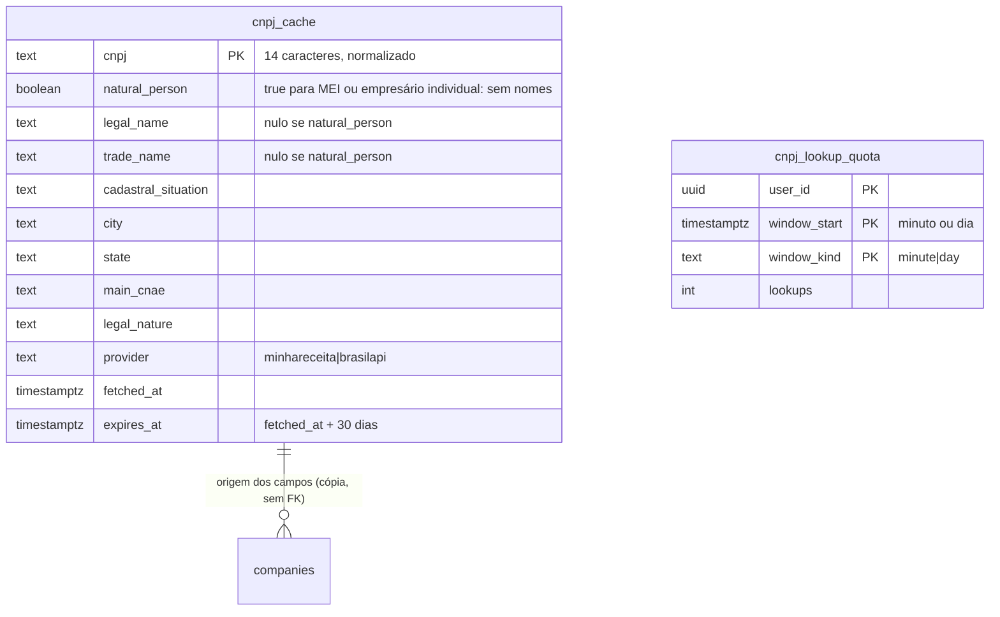

# ADR-0017 — Busca de CNPJ por serviço externo, via Edge Function

- Estado: **Proposta**, aguardando aprovação do responsável. Nenhuma migration nem função foi criada.
- Data: 2026-11-09
- Tarefa: [TASK-0038](../tasks/TASK-0038-busca-de-cnpj-por-servico-externo.md)
- Relacionadas: ADR-0012 (D9 a D11: empresa pré-cadastrada), ADR-0006 (ViaCEP), ADR-0014 (validação de CNPJ), TASK-0007 (base legal e retenção), TASK-0011 (representante verificado), parecer de plataforma do DevOps (Revisão 4, seção R4.1; Revisão 2, seção R2.5)

## Contexto

O responsável decidiu, em 2026-11-08, que a base de empresas do piloto terá duas fontes (ADR-0012, D9): a lista curada pela equipe e a busca por CNPJ numa API pública gratuita. A busca permite ao trabalhador registrar uma manifestação contra uma empresa que ainda não se cadastrou e cria uma **empresa pré-cadastrada**, fora do diretório e do ranking (D10), que a empresa pode reivindicar depois (D11).

É o primeiro serviço externo chamado pelo servidor da plataforma. Pelo AGENTS.md, exige tarefa, ADR e avaliação de privacidade antes da integração.

O DevOps testou três provedores em 2026-11-08, com o CNPJ público 00.000.000/0001-91 (parecer, R4.1). Os fatos abaixo vêm desse teste e das páginas dos provedores citadas nele; não foram verificados de novo nesta ADR.

| | Minha Receita | BrasilAPI | CNPJ.ws (pública) |
|---|---|---|---|
| Chave | não | não mencionada | não |
| Limite | diz que nenhuma consulta é recusada por limite | sem número; pede volume "de uma pessoa real" e proíbe crawling | 3 por minuto |
| Termos de uso | não localizados | beta, "ainda elaborando" | uso só "para benefício próprio do usuário" |
| SLA | nenhum | não encontrado | API pública fora do SLA |
| Privacidade do provedor | diz não registrar o CNPJ consultado nem o IP | não encontrada | não encontrada |
| Traz QSA e MEI | sim | sim | sim, e parte dos CPFs de sócios veio **sem máscara** |

## Problema

1. **A chamada revela a relação trabalhador–empresa.** Se o navegador chamar o provedor, como no ViaCEP (ADR-0006), o terceiro recebe o IP da pessoa, o CNPJ e o `Origin` da Escuta Aí. Para um trabalhador, isso indica que alguém daquele IP pesquisou o próprio empregador numa plataforma de escuta psicossocial.
2. **A resposta traz dado de pessoa física.** O quadro societário (QSA) traz nome de sócios, e a razão social de MEI e de empresário individual contém o nome da pessoa.
3. **O dado não pode vir do cliente.** O texto atual da ADR-0012 prevê que o front busque na API e envie o resultado a `preregister_company(p jsonb)`. Nesse caso, qualquer conta autenticada pode criar uma empresa pré-cadastrada com razão social e situação inventadas, e a origem gravada seria `cnpj_api`.
4. **Nenhum provedor tem SLA.** A busca não pode ser condição para registrar a manifestação.

## Decisões propostas

D1. **Provedores:** Minha Receita como principal e BrasilAPI como reserva, como recomenda o parecer. CNPJ.ws fica de fora pelo limite de 3 por minuto, pela restrição de uso nos termos e pelo CPF de sócio sem máscara.

D2. **A chamada roda numa Edge Function do Supabase (`cnpj-lookup`), nunca no navegador.** O provedor vê só o CNPJ e o IP do Supabase. O CNPJ vai no **corpo de um POST**, nunca na URL nem na query string, para não aparecer em logs de acesso.

D3. **Só usuário autenticado.** A função confere que o JWT é de uma conta (`role = authenticated`, com `sub`). Só o `verify_jwt` não basta, porque a chave anon também é um JWT válido. Os dígitos verificadores, inclusive do CNPJ alfanumérico, são validados antes de qualquer chamada externa, com a mesma regra de `private.valid_cnpj` (ADR-0014).

D4. **Lista branca na saída e no cache.** De toda a resposta do provedor, só se usam:
- razão social e nome fantasia;
- situação cadastral;
- município e UF;
- CNAE principal;
- natureza jurídica;
- provedor de origem e data da consulta.

Nunca se guardam nem se devolvem QSA, e-mail, telefone, endereço completo, capital social nem qualquer outro campo.

D5. **Sem nome de pessoa física.** Se a resposta indicar opção pelo MEI ou natureza jurídica de empresário individual, a função não devolve nem guarda razão social nem nome fantasia. Responde `manual`, e o caso segue pelo preenchimento manual da D8. Na implementação, a lista de códigos de natureza jurídica tratados como pessoa física é conferida na tabela oficial da Receita e fixada no código e no teste. Se a resposta não trouxer a natureza jurídica nem o indicador de MEI, vale a mesma regra.

D6. **Cache no banco: `private.cnpj_cache`, com 30 dias de validade.** A função consulta o cache primeiro e só chama o provedor quando não acha o CNPJ ou quando o registro venceu. O cache guarda só a lista branca da D4 e **não registra quem consultou**. Para CNPJ de MEI ou empresário individual, o cache guarda só o CNPJ e a marca `natural_person`, para não repetir a chamada. Uma rotina diária apaga os registros vencidos.

D7. **Ordem de chamada e tempo:** Minha Receita, depois BrasilAPI, depois `manual`, com timeout de 4 s por provedor e no máximo uma reserva por consulta. Nenhum erro bloqueia o fluxo: a resposta é `manual` e a tela segue editável.

D8. **A empresa pré-cadastrada nasce no banco, a partir do cache, nunca de dados enviados pelo cliente.** Esta decisão substitui o desenho de `preregister_company(p jsonb)` na ADR-0012:
- `preregister_company(p_cnpj text) → uuid`: se houver registro válido no cache e sem a marca de pessoa física, cria a empresa com `data_source = 'cnpj_api'` e `registration_status = 'pre_registered'`, copiando os campos do cache.
- `preregister_company_manual(p_cnpj text, p_name text, p_city text, p_state text) → uuid`: quando o cache não tem o CNPJ ou o CNPJ é de pessoa física. Cria com `data_source = 'manual'` (valor novo, a acrescentar à lista da ADR-0012) e `registration_status = 'pending_check'`, para a equipe conferir antes de qualquer convite.
- As duas validam os dígitos, devolvem a empresa existente se o CNPJ já estiver cadastrado ou pré-cadastrado (sem informar se há manifestações) e aplicam o limite de criação por conta e por hora da ADR-0012.

D9. **Limite por conta contra varredura.** No máximo 10 consultas por minuto e 50 por dia por conta, contadas em `private.cnpj_lookup_quota`. A tabela guarda só conta, janela e contagem, **sem o CNPJ**, e os registros com mais de 2 dias são apagados. Acima do limite, a resposta é `manual` com a mensagem "Limite de consultas atingido. Preencha os dados manualmente."

D10. **Logs sem a ligação conta–CNPJ.** A função registra só o resultado (`hit`, `miss`, `fallback`, `manual`, `natural_person`, `rate_limited`, `invalid`), o provedor e o tempo de resposta. Não registra CNPJ, conta, IP nem corpo da resposta. O teste confere o texto dos logs.

D11. **Dado da API não comprova representação.** A razão social e a situação cadastral servem só para identificar a empresa. Quem fala por ela continua dependendo da verificação da ADR-0012 (D1 a D3) e da TASK-0011.

## Avaliação de privacidade

| Item | Avaliação |
|---|---|
| Finalidade | Identificar a empresa contra a qual o trabalhador registra a manifestação e permitir que a equipe localize e convide a empresa (ADR-0012). |
| Dados que saem para o terceiro | Só o CNPJ, que é dado público de pessoa jurídica, mais o IP do Supabase. Nenhum dado da conta, do relato ou do trabalhador. |
| Dados que entram | Só a lista branca da D4. QSA e campos de contato são descartados em memória, sem log. |
| Dado pessoal de terceiro | A razão social de MEI e de empresário individual identifica uma pessoa física. A D5 impede que ela entre no banco por esse caminho. No preenchimento manual, o nome digitado pelo trabalhador pode ser de pessoa física: a empresa fica `pending_check`, a equipe confere, e o registro não aparece no diretório nem no ranking (ADR-0012, D10). |
| Dado sensível derivado | A ligação "esta conta pesquisou este CNPJ" sugere quem é o empregador do trabalhador. Mitigações: o cache não grava a conta, a cota não grava o CNPJ, e os logs não gravam nenhum dos dois. Resta um sinal fraco: a existência de um CNPJ no cache mostra que **alguém** o consultou nos últimos 30 dias, sem dizer quem. Só a equipe e as funções `security definer` leem o cache. |
| Base legal | Fica com o jurídico (TASK-0007). Para dado público de pessoa jurídica, o risco é baixo. O tratamento de dado de pessoa física (D5 e preenchimento manual) precisa de enquadramento. |
| Transferência e termos | A Minha Receita não tem termos localizados e a BrasilAPI está em beta, com termos "em elaboração". Usar provedor sem termos é decisão do responsável. |
| Retenção | Cache: 30 dias. Cota: 2 dias. A empresa pré-cadastrada segue a regra de retenção da TASK-0007. |
| Transparência | O aviso de privacidade (ADR-0015) deve citar que o CNPJ informado é consultado em base pública por um serviço externo, sem dados da pessoa. |

## Modelo (ERD)

`companies` recebe os campos da ADR-0012 (`registration_status`, `data_source`, `source_ref`, `source_fetched_at`, `cadastral_situation`). Esta ADR só acrescenta `manual` aos valores de `data_source`.

## Quem lê e quem escreve

| Dado | Conta autenticada | Anônimo | Edge Function (`service_role`) | Equipe |
|---|---|---|---|---|
| `private.cnpj_cache` | — (recebe só a resposta da função, já filtrada) | — | lê e grava | lê via `ops_*` |
| `private.cnpj_lookup_quota` | — | — | lê e grava | — |
| empresa pré-cadastrada | cria por `preregister_company` ou `preregister_company_manual`; encontra por `find_company_by_cnpj` | — | — | lê e corrige via `ops_*` (ADR-0012) |

As duas tabelas ficam no esquema `private`, com RLS ligada e sem nenhum `grant` para `anon` ou `authenticated`. A `service_role` é a que o Supabase já injeta na Edge Function: não há segredo novo para gerir.

## Contrato da função

- `POST /functions/v1/cnpj-lookup`, corpo `{"cnpj": "..."}`.
- Resposta `200` sempre que a entrada for válida: `{"status": "found", "company": {campos da D4}, "source": "minhareceita|brasilapi|cache"}` ou `{"status": "manual", "reason": "natural_person|unavailable|not_found|rate_limited"}`.
- `400` para CNPJ com formato ou dígito inválido, sem chamada externa.
- `401` sem sessão de conta.

## Riscos

- **Indisponibilidade ou mudança do provedor:** sem SLA nem termos estáveis, o formato pode mudar sem aviso. Mitigação: parser só da lista branca, teste de contrato com resposta gravada (fixture) e o preenchimento manual sempre disponível.
- **Empresa criada com nome errado no preenchimento manual:** fica `pending_check`, fora do diretório e do ranking, e a equipe confere.
- **Varredura de CNPJs por conta autenticada:** a cota limita por conta. Quem criar muitas contas contorna o limite; esse abuso depende dos controles de cadastro do Auth e fica fora desta ADR.
- **Edge Function nova:** é a primeira do projeto e exige deploy pela CLI, com a pasta `supabase/functions`. O DevOps define o deploy e o monitoramento. No plano Free, o parecer cita 500 mil invocações por mês.
- **Cadastro de empresa sem autocompletar:** o formulário de cadastro roda antes do login, então a busca não fica disponível nele (D3). Ver a decisão 4.

## Testes previstos

Edge Function (com o provedor simulado):
- CNPJ inválido não gera chamada externa;
- chamada sem sessão recebe `401`, e com a chave anon também;
- cache válido não chama o provedor;
- falha ou timeout da Minha Receita cai na BrasilAPI;
- falha das duas devolve `manual`;
- MEI e empresário individual devolvem `manual` sem nome, e o cache não guarda nome;
- QSA e campos de contato não aparecem na resposta nem no cache;
- a cota bloqueia a 11ª consulta no minuto;
- os logs não contêm CNPJ nem conta.

Banco (`supabase/tests/cnpj_smoke.sql`):
- `preregister_company` sem cache recusa;
- com cache, cria com `cnpj_api`;
- com a marca de pessoa física, recusa e aponta o manual;
- o manual cria com `pending_check`;
- CNPJ existente devolve a mesma empresa;
- o limite por hora vale;
- `authenticated` não lê nem grava o cache e a cota;
- a empresa pré-cadastrada não aparece no diretório nem no ranking.

## Rollback

Desligar a função: o front passa ao preenchimento manual, que já é o caminho de erro. Revogar `preregister_company`, mantendo a versão manual. Cache e cota podem ser esvaziados sem perda, e as empresas criadas ficam com a origem registrada.

## Alternativas rejeitadas

- **Chamada direta do navegador**, como no ViaCEP: expõe o IP e a relação trabalhador–empresa ao terceiro (Problema 1).
- **Base própria da Receita**, completa ou filtrada (parecer, R2.5, opções A e B): não cabe no Free, exige carga mensal e traz dados de pessoas físicas sem finalidade.
- **CNPJ.ws:** limite de 3 por minuto, restrição de uso e CPF de sócio sem máscara.
- **Front enviando os dados da empresa** a `preregister_company(p jsonb)`: permite forjar razão social e origem (Problema 3).

## Decisões que dependem do responsável

1. Aceitar Minha Receita e BrasilAPI sem termos de uso publicados (a primeira sem termos localizados, a segunda em beta).
2. Aceitar o preenchimento manual com `pending_check` quando o CNPJ for de pessoa física ou estiver indisponível, ou recusar a manifestação nesses casos.
3. Os limites da D9 (10 por minuto e 50 por dia) e a validade de 30 dias do cache.
4. No cadastro de empresa, que roda sem login: manter o preenchimento manual (recomendado), ou liberar a busca para `anon` com outra proteção contra abuso, o que exigiria revisão desta ADR.
5. A ordem de implementação: depois da migration da ADR-0012 (`registration_status` e `data_source`), da qual esta depende.
