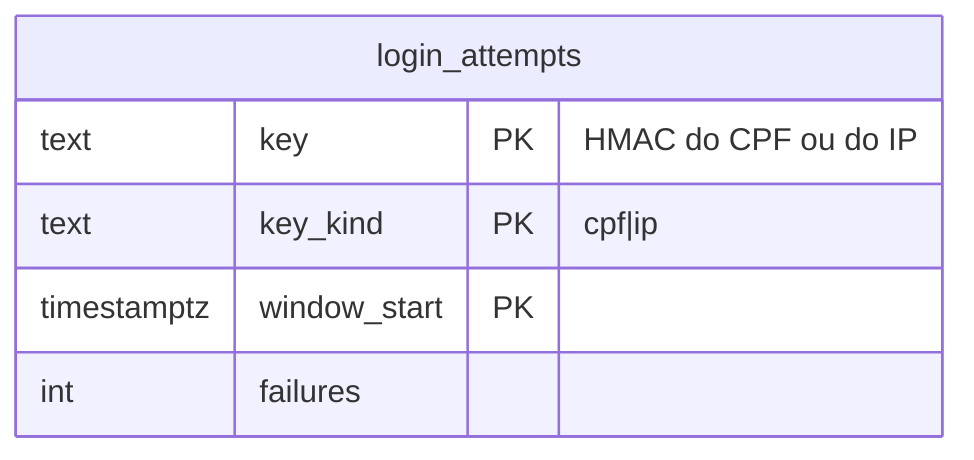

# ADR-0018 — Entrar com CPF e senha (trabalhador)

- Estado: **Proposta**, aguardando decisão do responsável. Nenhum código nem migration foi criado.
- Data: 2026-11-09
- Tarefa: [TASK-0039](../tasks/TASK-0039-entrar-com-cpf.md)
- Relacionadas: ADR-0009 (Supabase Auth), ADR-0014 e a migration `20261109140000_cpf_unico.sql` (CPF único), TASK-0005 (autenticação e sessões), ADR-0017 (padrão de Edge Function)

## Contexto

Hoje todas as contas entram com e-mail e senha pelo Supabase Auth. Desde 2026-11-09 o CPF é único entre trabalhadores (`workers_cpf_key`). O pedido é permitir que o trabalhador entre com CPF e senha.

O Supabase Auth só identifica a conta por e-mail ou telefone. Entrar com CPF exige que o servidor descubra o e-mail a partir do CPF, sem que esse e-mail nem a existência da conta cheguem ao navegador.

## Problema

1. **Enumeração:** numa plataforma de escuta psicossocial, saber que um CPF tem conta já é informação sensível: indica que a pessoa registrou ou pode registrar manifestação. O login pode vazar isso de quatro formas:
   - mensagens diferentes para "CPF não existe", "senha errada" e "e-mail não confirmado";
   - tempo de resposta diferente quando o CPF não existe;
   - bloqueio por excesso de tentativas aplicado só a CPFs existentes;
   - uma função que devolva o e-mail, mesmo mascarado.
2. **O CPF não é segredo.** Ele circula em cadastros e vazamentos. A senha passa a ser a única barreira, e a força bruta por CPF fica mais fácil de mirar do que por e-mail.
3. **Limite do Auth concentrado:** se o login passar por uma função de servidor, todas as tentativas chegam ao Auth com o mesmo IP. O limite por IP do Auth deixa de distinguir pessoas, e uma pessoa pode esgotá-lo para todas.
4. **Escopo:** só o trabalhador tem CPF único. Parceiro pessoa física tem CPF em `partners.document`, sem unicidade. Empresa e patrocinador não têm CPF.

## Opções

| Opção | Como | Avaliação |
|---|---|---|
| **A. Edge Function `cpf-login`** | O navegador envia CPF e senha à função. Ela acha o e-mail pelo CPF com a `service_role`, chama o endpoint de senha do Auth no servidor e devolve a sessão. O front aplica a sessão com `setSession`. | **Recomendada**, com os controles da seção Decisão. O e-mail nunca sai do servidor. |
| B. RPC que devolve o e-mail do CPF | O front chama a RPC e depois `signInWithPassword` com o e-mail. | Rejeitada: entrega o e-mail e confirma a existência da conta a quem souber um CPF. |
| C. Conta criada com e-mail sintético (`<cpf>@...`) | O CPF vira o "e-mail" no Auth. | Rejeitada: quebra a confirmação e a recuperação por e-mail e grava o CPF em `auth.users.email`, com cópia em logs do Auth. |
| D. Não fazer | Login só por e-mail. | Sem risco novo. O trabalhador precisa lembrar o e-mail usado no cadastro. |

## Decisão proposta (se A for aprovada)

D1. **Só para trabalhador.** A busca é em `public.workers.cpf`. A conta que também tem outros perfis entra igual e vê os mesmos perfis de hoje. O login por e-mail continua para todos.

D2. **Resposta única.** Para CPF inexistente, senha errada, conta bloqueada ou e-mail não confirmado, a função devolve o mesmo status e o mesmo texto: "CPF ou senha inválidos. Se você acabou de se cadastrar, confirme o e-mail antes de entrar." A tela mostra sempre esse texto completo.

D3. **Tempo uniforme.** Quando o CPF não existe, a função faz mesmo assim uma chamada ao endpoint de senha com um e-mail que não existe, para o tempo de resposta ficar parecido. A medição de tempo entra nos testes.

D4. **Limite próprio, aplicado a qualquer CPF.** A contagem vai para `private.login_attempts`, com duas chaves:
- HMAC do CPF com um segredo da função (pepper). Não se usa hash simples: o espaço de CPFs é pequeno e um hash simples seria revertido;
- HMAC do IP de origem.

Limite proposto: 5 falhas por CPF em 15 minutos e 30 por IP em 15 minutos. Acima disso, a resposta é a da D2, sem chamar o Auth, e vale também para CPFs que não existem. Os registros são apagados depois de 24 horas. Na implementação, confere-se qual cabeçalho traz o IP de origem nas Edge Functions do Supabase.

D5. **Captcha:** recomendado no login por CPF, porque o CPF é previsível. O Supabase Auth aceita captcha (hCaptcha ou Cloudflare Turnstile), e a função repassaria o token. Isso cria um serviço externo novo e é decisão à parte.

D6. **Recuperação de senha só por e-mail.** Não haverá "esqueci a senha" por CPF: ele exigiria mostrar o e-mail, mesmo mascarado, ou confirmar que o CPF existe.

D7. **Logs:** a função registra só o resultado (`ok`, `invalid`, `rate_limited`) e o tempo. Nunca registra CPF, e-mail, senha, IP nem corpo da requisição. A senha só existe em memória durante a chamada ao Auth.

D8. **Sem dado novo do trabalhador.** A única tabela nova é a de tentativas, sem CPF nem IP em claro. O segredo HMAC fica nos segredos da função, fora do Git.

## Modelo

Fica em `private`, com RLS ligada e sem nenhum `grant`. Só a função grava e lê, com a `service_role`.

## Riscos

- **Enumeração residual pelo cadastro:** o cadastro já revela, de forma indireta, que um CPF válido tem conta (ADR-0014, adendo de 2026-11-09). O login por CPF não pode abrir um segundo caminho; os testes conferem as respostas idênticas.
- **Força bruta distribuída:** o limite por CPF segura ataques a uma pessoa. Contra muitos CPFs testados de muitos IPs, só o captcha ajuda.
- **Bloqueio de terceiros:** quem souber o CPF de alguém consegue travar o login por CPF dessa pessoa por 15 minutos. O login por e-mail continua disponível.
- **Senha em trânsito pela função:** a senha passa pela Edge Function. A função não loga o corpo, e o transporte é HTTPS. O risco é o mesmo de qualquer servidor que recebe credenciais.

## Testes previstos

- CPF inexistente, senha errada e e-mail não confirmado devolvem o mesmo status e o mesmo corpo.
- A diferença de tempo entre CPF existente e inexistente fica dentro de uma margem definida no teste.
- O limite por CPF vale também para CPF inexistente.
- O limite por IP funciona.
- A sessão devolvida funciona no portal do trabalhador.
- Os logs da função não contêm CPF, e-mail nem IP.
- `authenticated` e `anon` não leem `private.login_attempts`.
- CPF com dígito inválido recebe a resposta da D2, sem consulta ao banco.

## Rollback

Desligar a função e esconder a opção "Entrar com CPF". O login por e-mail não muda. A tabela de tentativas pode ser apagada sem perda.

## Decisões que dependem do responsável

1. Adotar a opção A ou manter só o e-mail (D).
2. Captcha no login por CPF (recomendado), com a escolha do provedor como serviço externo.
3. Os limites da D4.
4. O texto único da D2.
5. Incluir ou não o parceiro pessoa física. Recomendo não incluir: o CPF dele não é único.
