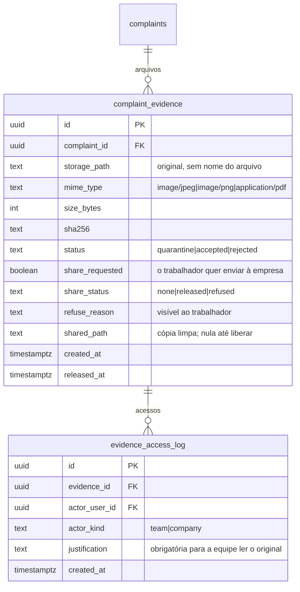

# ADR-0019 — Arquivos de prova enviados pelo trabalhador

- Estado: **Proposta**, aguardando decisão do responsável. Nenhum código, bucket nem migration foi criado.
- Data: 2026-11-09
- Tarefa: [TASK-0040](../tasks/TASK-0040-arquivos-de-prova-na-manifestacao.md)
- Relacionadas: ADR-0010 (revisão antes de liberar à empresa), ADR-0009 (bucket `partner-media`), TASK-0007 (base legal e retenção), `docs/security/THREAT_MODEL.md` ("Upload malicioso: não implementar sem quarentena, limites e scanning"), parecer jurídico de 2026-11 (seção 6.1)

## Contexto

Hoje a manifestação não aceita arquivos. O único upload do sistema é a foto de parceiro, no bucket `partner-media`. O pedido é deixar o trabalhador enviar arquivos de prova e a empresa recebê-los **conforme o plano**.

Não encontrei no código, nos documentos nem no parecer jurídico nenhuma regra que diga quais planos recebem provas. Essa definição fica com o responsável (decisão 1). O parecer não trata de provas do trabalhador. A seção 6.1 dá os princípios aplicáveis: minimização, perfis de acesso, trilha, retenção limitada e não coletar identificadores sem finalidade.

## Problema

1. **O arquivo identifica o trabalhador.**
   - Foto: os metadados EXIF podem trazer o local por GPS, o aparelho e a data.
   - PDF: o autor e o software ficam nas propriedades.
   - Captura de tela: costuma mostrar nome, foto de perfil, número de telefone ou a conversa inteira.
   
   Entregar o arquivo à empresa pode revelar quem fez a manifestação. Isso fere a regra central de que a empresa nunca acessa a identidade do trabalhador.
2. **Dado sensível.** O trabalhador pode enviar atestado, laudo ou receita, que são dados de saúde e dado pessoal sensível pela LGPD. Pode também enviar dados de colegas.
3. **Arquivo malicioso.** O PDF pode ter script embutido e a imagem pode explorar o leitor. O Supabase não faz varredura de vírus. Mandar o arquivo a um antivírus online, como o VirusTotal, publicaria a prova para terceiros.
4. **Custo e cota.** O Storage do plano Free tem cota limitada (o valor exato fica para o DevOps confirmar) e não entra no backup atual (parecer de plataforma, Revisão 2).
5. **Retenção.** Sem a TASK-0007, não há prazo para apagar.

## Decisões propostas

D1. **O original é como o relato original.** O arquivo enviado fica num bucket privado (`complaint-evidence`), no caminho `<complaint_id>/<uuid>`, **sem o nome original do arquivo**. Lê o original:
- o trabalhador dono da manifestação;
- a equipe, só com justificativa registrada, no mesmo padrão de `ops_read_original`.

A empresa nunca lê o original.

D2. **A empresa recebe só uma cópia revisada, por decisão do trabalhador e liberação da equipe.**
1. O trabalhador marca o arquivo como "pode ir para a empresa".
2. A equipe confere o arquivo na revisão da ADR-0010 e libera ou recusa. A recusa tem motivo e é visível ao trabalhador.
3. Na liberação, o servidor gera uma cópia limpa:
   - imagem: decodificada e regravada em JPEG ou PNG, o que remove todos os metadados;
   - PDF: convertido em imagens das páginas, o que remove script, metadados e camadas ocultas.
   
   A empresa só recebe essa cópia. O conteúdo visível, como nome numa captura de tela, é responsabilidade da revisão humana. A equipe pode recusar e pedir ao trabalhador uma versão sem identificação.

D3. **Acesso da empresa por link temporário e registrado.** A empresa pede o arquivo por RPC, só se a manifestação estiver liberada e o plano permitir. Recebe uma URL assinada que vale 5 minutos. Cada acesso grava quem, quando e qual arquivo, o que atende à prova de disponibilização da seção 6.1 do parecer.

D4. **Limites no envio:**
- só JPEG, PNG e PDF (sem Office, ZIP, áudio ou vídeo no piloto);
- até 10 MB por arquivo e até 5 por manifestação;
- `allowed_mime_types` e `file_size_limit` no bucket;
- conferência do tipo real pelos primeiros bytes, porque a extensão e o MIME declarado podem mentir.

D5. **Quarentena.** O envio cai num prefixo de quarentena. Uma Edge Function confere tipo, tamanho e tipo real e calcula o SHA-256. Só então move o arquivo para o caminho definitivo e marca `accepted`. O que falhar é apagado e marcado `rejected`, com motivo técnico, sem conteúdo.

D6. **Varredura de vírus.** Opções:
- (a) ClamAV num serviço próprio, com custo e infraestrutura;
- (b) nenhuma varredura, com os limites da D4 e a cópia limpa da D2;
- (c) antivírus online, rejeitado porque envia a prova a terceiros.

Recomendo (b) no piloto. A equipe abre os originais num visualizador do navegador, nunca baixa e executa. A empresa só recebe a cópia regravada, que neutraliza a maior parte do conteúdo ativo. A opção (a) entra se o volume crescer.

D7. **Aviso antes do envio:** "Não envie atestados, laudos ou outros documentos de saúde, nem dados de outras pessoas. Antes de enviar uma captura de tela, apague nomes e fotos." O aviso não substitui a revisão da D2.

D8. **Retenção e exclusão.** Os arquivos seguem a retenção da manifestação (TASK-0007). Se a manifestação for retirada antes da liberação, original e cópia são apagados. O Storage fica fora do backup. A decisão de incluí-lo, ou de aceitar a perda, fica com o responsável e o DevOps.

D9. **Logs.** Sem nome de arquivo, conteúdo ou URL assinada nos logs. Só id, tipo, tamanho e resultado.

## Modelo (ERD)

## Quem lê e quem escreve

| Dado | Trabalhador | Empresa | Equipe |
|---|---|---|---|
| arquivo original | envia e lê os próprios | **nunca** | lê com justificativa (fica no log) |
| cópia limpa | — | lê por URL de 5 minutos, se liberada e se o plano permitir | gera ao liberar |
| `complaint_evidence` | lê os próprios por RPC (sem `shared_path`) | lê id e tipo dos liberados, por RPC | lê tudo e decide por `ops_*` |
| `evidence_access_log` | — | — | lê |

Bucket privado, sem política de leitura para `anon` nem `authenticated`. O envio do trabalhador vai para a quarentena por política restrita a `<complaint_id>` de manifestação própria. Todo o resto passa por RPC ou Edge Function com URL assinada.

## Riscos

- **Reidentificação pelo conteúdo:** a cópia limpa remove metadados, mas não o que está na imagem. A revisão humana é o único controle, e falhas aqui expõem o trabalhador.
- **Carga na equipe:** cada arquivo é mais um item na fila da ADR-0010.
- **Dado de saúde apesar do aviso:** a equipe recusa o compartilhamento. O original fica guardado sob a regra de retenção, e a decisão de apagar na hora fica com o jurídico.
- **Conversão de PDF na Edge Function:** a viabilidade, o tempo e a memória precisam ser testados. Se não couber, o PDF fica só para a equipe no piloto, sem compartilhamento.
- **Cota e backup:** sem backup do Storage, a perda do arquivo é definitiva.

## Testes previstos

- Tipo fora da lista é recusado; arquivo acima de 10 MB também.
- PDF renomeado para `.jpg` é recusado pela conferência do tipo real.
- O sexto arquivo da manifestação é recusado.
- Outra conta não lê o arquivo do trabalhador, nem pela API do Storage nem por RPC.
- A empresa não lê o original e não recebe link antes da liberação nem sem o plano.
- A cópia limpa não tem EXIF nem metadados de PDF.
- A URL assinada expira.
- Cada acesso da empresa e cada leitura do original pela equipe fica registrado.
- A retirada da manifestação apaga os arquivos.
- Nenhum log contém nome de arquivo nem URL.

## Rollback

Desligar o envio no front e revogar as RPCs de envio e de acesso da empresa. Os arquivos ficam no bucket privado sob a regra de retenção até a decisão de apagar.

## Decisões que dependem do responsável

1. **Quais planos** dão à empresa o direito de receber provas. Não há regra escrita hoje.
2. Se a empresa recebe arquivos já no piloto, ou se no piloto só a equipe vê os arquivos (recomendo esta, para validar a revisão antes).
3. A varredura: (b) no piloto (recomendado) ou (a) com custo.
4. Tipos, tamanho e quantidade da D4.
5. Base legal e retenção, com o jurídico (TASK-0007), inclusive o que fazer com dado de saúde enviado apesar do aviso.
6. Incluir ou não o Storage no backup.
