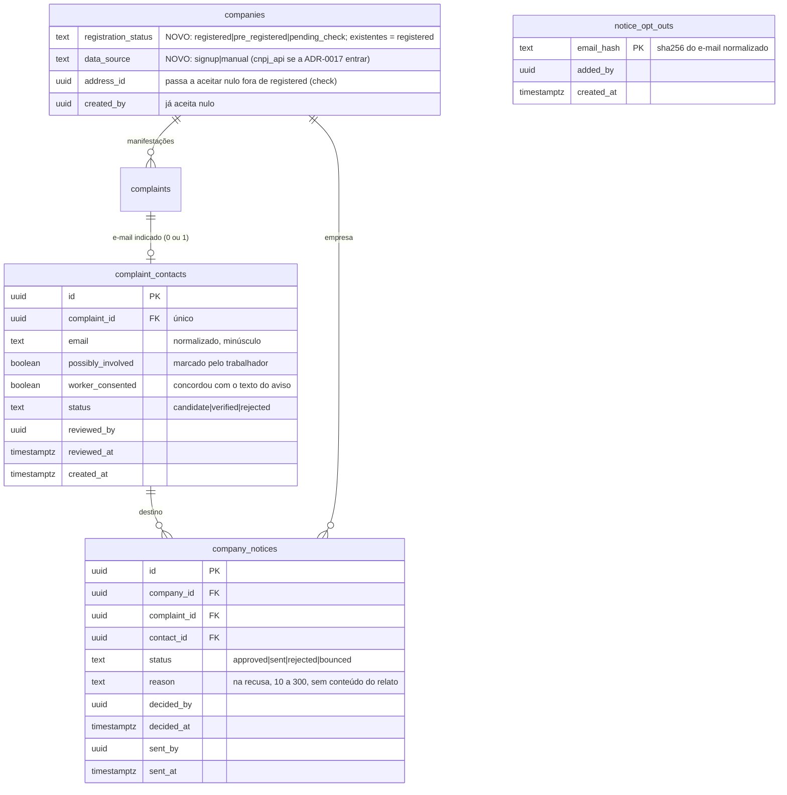

# ADR-0023 — Relato contra empresa não cadastrada no piloto, com aviso à empresa sem conteúdo

- Estado: **Proposta (plano)**. Nenhuma migration, função ou Edge Function foi criada. O modelo precisa da aprovação do responsável antes de qualquer código.
- Data: 2026-11-17
- Origem: decisão do responsável, repassada pelo Gestor em 2026-11-17: o trabalhador encontra qualquer empresa e relata contra ela; se a empresa não estiver cadastrada, ela recebe um aviso, sem conteúdo, de que existe um relato, no e-mail que o trabalhador informou. Vale para o piloto, não para depois.
- Relacionadas: ADR-0012 (D4, D5, D7, D9 a D11, C1 a C3), ADR-0017 (busca de CNPJ), ADR-0020 (e-mail pelo Gmail), ADR-0010 (revisão humana), TASK-0007 (base legal e retenção)

## O que muda em relação às decisões anteriores

1. **A ADR-0012 D5 proíbe que o texto do convite cite a manifestação.** O pedido do responsável ("informar a empresa que existe um relato") muda essa regra. A mudança precisa ser registrada como decisão dele, porque é o ponto de maior risco deste plano (ver Riscos).
2. **A ADR-0012 tirou D4 e D9 a D11 do recorte do piloto** (revisão de 2026-11-17). Este plano traz de volta uma parte mínima deles.
3. **A troca do gate (20261117130000) passa a ser pré-requisito.** A empresa avisada vai se cadastrar. Sem o gate, a primeira conta que cadastrar aquele CNPJ vê os casos liberados, sem verificação. Esse é exatamente o risco que a ADR-0012 fecha.

## 1. Recorte mínimo

O fluxo do trabalhador:
1. Digita o CNPJ. Se a empresa existe, o fluxo é o de hoje.
2. Se não existe, cria a empresa pré-cadastrada (ADR-0012 D9, D10).
3. Informa, se quiser, **um** e-mail da empresa para o aviso e responde se essa pessoa pode estar envolvida (D4).
4. Concorda explicitamente com o texto: "A empresa receberá um aviso de que existe um relato na plataforma, sem o conteúdo, sem o seu nome e sem a data."

Na Operação, a equipe:
1. revisa a manifestação, como hoje (ADR-0010);
2. confere a empresa (`pending_check`) e o contato;
3. aprova ou recusa o aviso;
4. envia o aviso.

Quando a empresa se cadastra com aquele CNPJ, a conta é ligada à empresa existente com vínculo `pending` (D11). O acesso aos casos depende da verificação (V1, já aprovada).

**Recomendação para caber no prazo:** pré-cadastro só manual no piloto, **sem a Edge Function da ADR-0017**. O trabalhador digita o CNPJ (com dígitos validados no banco), o nome e o município/UF. A empresa nasce `pending_check`, e a equipe confere o CNPJ na consulta pública da Receita antes de aprovar o aviso. A Edge Function, o cache e as cotas da ADR-0017 entram depois do piloto. Isso tira do caminho crítico:
- o primeiro serviço externo chamado pelo servidor;
- a falta de SLA dos provedores;
- a cota contra varredura;
- o deploy de função, que, sem projeto de desenvolvimento, só pode ser testado em produção.

**Se o responsável quiser a busca automática já no piloto**, ela entra como na ADR-0017 (D2 a D10), sem mudança. O custo e o canal ficam com o DevOps.

### O que fica de fora do recorte

- token de convite (D5, D6);
- nome, telefone e cargo do contato (só e-mail);
- lembretes de 7 e 15 dias (D12);
- `risk_level` (fica R3: risco alto vira `held` e não gera aviso);
- opt-out por link (no piloto, o pedido de não receber é atendido pela equipe e entra na lista);
- botão de envio (ver variante a2).

## 2. Variantes de envio

### (a) A equipe aprova na Operação e envia — recomendada

- **(a1) Manual:** a equipe copia o texto fixo, envia pela conta da plataforma e marca como enviado (quem e quando). Não precisa de infraestrutura nova. Funciona no primeiro dia.
- **(a2) Botão:** a aprovação grava o aviso numa fila, e uma Edge Function envia pelo SMTP do Gmail. Depende da ADR-0020: o teste da porta 465 ainda não foi feito, a conta dedicada não existe e a ADR é só proposta. Fica para depois do piloto, salvo se o DevOps fechar a ADR-0020 a tempo.

Travas no banco, nas duas formas:
- Não há aviso enquanto a manifestação não tiver passado pela revisão da equipe.
- Não há aviso se o contato foi marcado como possivelmente envolvido.
- Não há aviso se o e-mail estiver na lista de opt-out.
- Não há aviso se a manifestação estiver `held`, o que inclui o risco alto pela R3.
- Não há aviso se a empresa ainda estiver `pending_check`.
- No máximo um aviso por empresa num intervalo (proposta: 30 dias), mesmo com várias manifestações.

### (b) Envio automático ao e-mail indicado pelo trabalhador — não recomendada

O que fere:
- **ADR-0012 D4:** o contato indicado é candidato, nunca destino verificado. O envio automático usa como destino um e-mail que ninguém conferiu.
- **ADR-0012 D4 (segunda regra):** o contato possivelmente envolvido não pode receber. O trabalhador pode não saber quem está envolvido, e só a equipe consegue conferir que o e-mail é de um canal institucional e não de uma pessoa.
- **ADR-0012 D7:** caso de risco alto não gera contato automático. No envio automático, o aviso sai antes de qualquer pessoa avaliar o risco.
- **ADR-0012 C3:** o convite automático foi excluído do piloto expressamente, por contrariar a regra de não haver contato externo sem revisão, e porque depende da ADR-0020, que não está pronta.
- **ADR-0012 D5:** o texto não pode citar a manifestação. Isso vale também para a variante (a) e precisa da decisão do item 1 de "O que muda".
- **AGENTS.md:**
  - "Casos de alto risco não geram contato externo automático": no momento do envio automático, o risco é desconhecido.
  - "Não introduzir serviços externos... sem tarefa e decisão registradas": o envio pela aplicação é serviço novo (ADR-0020, só proposta).
  - "Nunca enviar... dados psicossociais a terceiros sem avaliação de privacidade, base legal e controles documentados": "existe um relato contra você" é informação sobre o caso, enviada a um endereço que ninguém conferiu.
- **Abuso:** qualquer conta autenticada faria a plataforma mandar e-mail para qualquer endereço. Serviria para assédio, para spam e para derrubar a conta do Gmail, que é a mesma do Auth: a confirmação de cadastro pararia.

### Remetente no piloto (responsável, 2026-11-17)

"Por hora vai ser da minha conta, mas vamos abrir uma para a empresa": no piloto, o aviso sai da conta pessoal de e-mail do responsável. Ainda falta ele escolher entre envio manual (a1) e automático (a2 ou b). Efeito em cada variante:

- **(a1) manual:** funciona sem mudança. Ele envia da própria caixa, com o texto fixo, e marca como enviado na Operação. Nenhuma credencial vai para a plataforma.
- **(a2) e (b), automáticas:** a Edge Function precisaria da senha de app SMTP da conta pessoal nos Secrets. A ADR-0020 D1 desaconselha isso: a senha de app dá acesso SMTP à caixa inteira, e um vazamento da função expõe o e-mail pessoal do responsável. Se a escolha for automática, o caminho é abrir antes a conta da empresa e só então ligar o envio.
- **Em qualquer variante:**
  - O destinatário vê o nome e o e-mail pessoal do responsável, e as respostas da empresa caem na caixa pessoal dele, possivelmente com dado do caso ou de terceiros. Essas mensagens precisam de tratamento e retenção definidos (TASK-0007).
  - Se o Auth usar a mesma conta, o limite de 500 envios por dia e o risco de bloqueio são compartilhados. O DevOps confirma qual conta o Auth usa hoje.
  - Quando a conta da empresa existir, os avisos passam a sair dela. O texto não muda.

## 3. Modelo (para aprovação)

- **Quem lê:** a empresa nunca lê `complaint_contacts`, `company_notices` nem `notice_opt_outs`. O trabalhador lê só o próprio contato e o estado do aviso (enviado ou não, sem data exata). A equipe lê pelas funções `ops_*`. Tudo fica com RLS ligada, `revoke all` e acesso só por função.
- **Trilha:** `company_notices` é só inserção, com mudança de estado registrada. `private.block_trail_change` vale para linhas `sent` e `rejected`.

### Migrations previstas (nenhuma escrita)

| Ordem | Migration | Conteúdo | Muda acesso? |
|---|---|---|---|
| 0 | `20261117130000` (já pronta) | troca do gate | sim (já aprovada; pré-requisito) |
| 1 | `..._empresa_pre_cadastrada_estrutura` | colunas de `companies` + checks; `complaint_contacts`; `company_notices`; `notice_opt_outs` | não |
| 2 | `..._empresa_pre_cadastrada_funcoes` | funções abaixo; filtros de listagem | sim (listagens e criação de empresa) |
| 3 | `..._reivindicacao_cnpj` | `private.create_profile` com a D11 | sim (cadastro: autenticação) |

A 3 fica separada porque mexe no cadastro de todas as contas de empresa e tem rollback próprio.

### Funções

- `find_company_by_cnpj(p_cnpj) → (id, name, city, state)`: devolve a empresa existente sem dizer se ela é pré-cadastrada nem se tem manifestação.
- `preregister_company_manual(p_cnpj, p_name, p_city, p_state) → uuid`: valida os dígitos (`private.valid_cnpj`), cria `pending_check` e devolve a existente se o CNPJ já estiver na base. Limite proposto: 3 por conta por dia.
- `create_complaint(p, p_share)`: aceita `p.notice_contact {email, possibly_involved, consent}`. Recusa e-mail inválido e contato sem consentimento.
- `ops_list_pending_companies()` e `ops_review_company(p_company, p_decision, p_reason)`: `pending_check` → `pre_registered` ou recusa.
- `ops_list_notices(p_status)`, `ops_decide_notice(p_complaint, p_decision, p_reason)` (com as travas da variante a), `ops_mark_notice_sent(p_notice)` e `ops_add_opt_out(p_email)`.
- `my_notice_status(p_complaint)`: para o trabalhador.
- Filtro `registration_status = 'registered'` em `list_company_directory`, `company_responsiveness`, `company_ranking` e `list_partner_companies`. Conferir, na implementação, toda função que lê `companies`.
- `private.create_profile`: CNPJ pré-cadastrado no cadastro de empresa liga a conta como membro `pending` e passa a empresa a `registered`. Uma segunda conta entra como membro `pending`, nunca como dono.

### Testes

- Smoke próprio de cada migration.
- `isolation_smoke.sql` com empresa pré-cadastrada (as tabelas novas entram sozinhas pelo catálogo).
- Teste tx em produção, rodada por rodada, com liberação escrita.

## 4. Estimativa honesta

Hoje é 17/11. O alvo é tudo aplicado até 24/11; o go/no-go é em 25/11.

| Trabalho | Quem | Estimativa |
|---|---|---|
| Aprovação do modelo e do texto do aviso | responsável (+ advogado para o texto e a base legal) | 1 dia, se vier até 18/11 |
| Migrations 1 a 3, smokes, testes tx e scripts para o SQL Editor | Back | 3 dias |
| Busca/pré-cadastro no assistente, contato e consentimento, fila de avisos e conferência de empresa na Operação | Front | 3 a 4 dias |
| Aplicação manual pelo responsável, com rodadas de teste | responsável | 1 dia |
| Edge Function da ADR-0017 (se entrar) | Back + DevOps | +2 dias, testados só em produção |
| Botão de envio (a2) | Back + DevOps | +2 a 3 dias, depende da ADR-0020 |

**Avaliação:** a variante (a1) com pré-cadastro manual cabe até 24/11 só se o modelo for aprovado até 18/11 e não houver retrabalho. Não sobra margem, e a fila atual continua: o lote de quatro migrations, a 130000 depois da fila do Front, os termos em 24/11 e as rodadas do isolation_smoke. Com a Edge Function ou com o botão, **não cabe com segurança**.

**Se não couber, sai nesta ordem:**
1. o botão (fica o envio manual);
2. a Edge Function (fica o pré-cadastro manual);
3. a reivindicação automática (D11).

Sem a D11, a empresa avisada não consegue se cadastrar pelo site, porque o CNPJ já existe. A equipe faria a ligação por uma função `ops_*` simples. A D11 só sai como último recurso.

**Nada sai das travas da variante (a).**

## 5. Riscos

- **E-mail errado ou da pessoa envolvida.**
  - O aviso "existe um relato" que chega à pessoa envolvida, sobretudo em empresa pequena, pode identificar o trabalhador pelo momento e expô-lo a retaliação. Esse é o maior risco do plano, e só o envio aprovado pela equipe o reduz.
  - A equipe confere se o e-mail é um canal institucional (RH, ouvidoria, contato do site) e recusa e-mail pessoal ou de pessoa nomeada.
  - O aviso não sai logo após o relato: é enviado só depois da revisão, sem data.
  - Mesmo assim, o risco residual existe e precisa de aceite do responsável.
- **Abuso (envio a qualquer endereço).** Na variante (a), nenhum envio sai sem a equipe. A trava é ainda:
  - um contato por manifestação;
  - um aviso por empresa a cada 30 dias;
  - limite de pré-cadastro por conta;
  - lista de opt-out.

  Na variante (b), não há trava efetiva.
- **MEI ou pessoa física.**
  - O CNPJ de MEI ou de empresário individual identifica uma pessoa (ADR-0012 D9, ADR-0017 D5). Uma empregada doméstica, por exemplo, relataria contra uma pessoa física.
  - No pré-cadastro manual, o banco não detecta isso; a equipe confere na Receita em `pending_check`.
  - Proposta: a manifestação é aceita, mas o aviso é recusado quando a empresa é pessoa física. A decisão é do responsável.
- **Dado de terceiro.**
  - O e-mail do contato é dado pessoal de terceiro, que não consentiu. O nome digitado no pré-cadastro manual também pode ser de pessoa física.
  - Base legal e retenção ficam com o advogado (TASK-0007). Proposta: apagar o contato 90 dias depois do encerramento da manifestação ou da recusa do aviso.
- **Gmail.**
  - Um e-mail "existe um relato contra a sua empresa", vindo de um Gmail, parece golpe: vai para spam ou é denunciado.
  - Denúncias e o limite de 500 por dia podem bloquear a conta. Se for a mesma do Auth, a confirmação de cadastro para.
  - Mitigações: conta dedicada (ADR-0020 D1), volume baixo e manual, e um texto que oriente a empresa a entrar pelo endereço oficial digitado, sem link clicável. O canal e o custo ficam com o DevOps.
- **Existência como sinal.** Uma empresa pré-cadastrada indica que alguém relatou contra ela. Por isso, `find_company_by_cnpj` não informa o estado, e a empresa pré-cadastrada não aparece em diretório, ranking nem responsividade.
- **Sem projeto de desenvolvimento.** Toda a validação roda em produção, em transação desfeita, com liberação escrita por rodada. Isso alonga o calendário da seção 4.

## Decisões que dependem do responsável

1. Texto do aviso citando que existe um relato: muda a ADR-0012 D5. O texto final passa pelo advogado.
2. Variante (a1) no piloto, com (a2) depois; ou outra.
3. Pré-cadastro só manual no piloto, ou com a Edge Function da ADR-0017.
4. Pessoa física/MEI: aceitar a manifestação e recusar o aviso, ou recusar as duas.
5. Intervalo mínimo entre avisos à mesma empresa (proposta: 30 dias) e retenção do contato (proposta: 90 dias).
6. Aceite do risco residual de o aviso chegar à pessoa envolvida.
